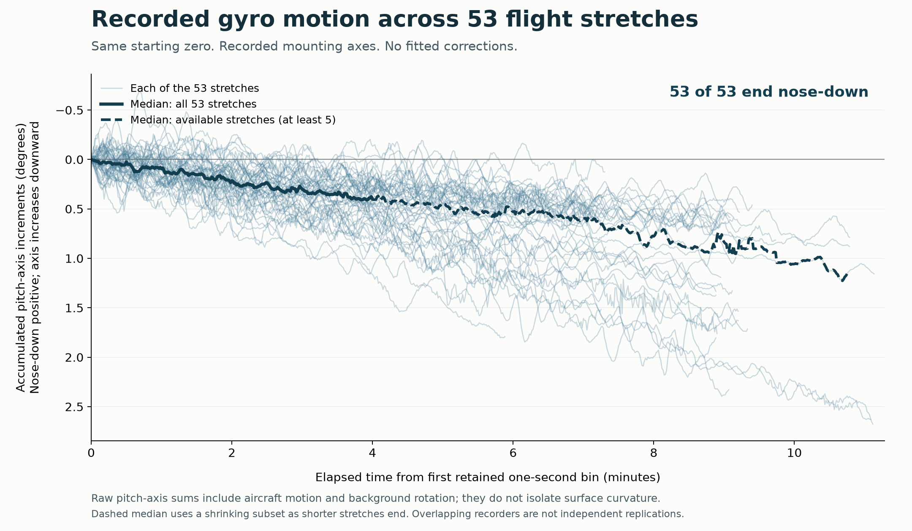
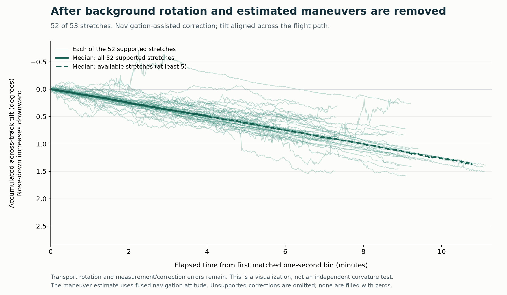

# Local Level Lab

**Testing Earth’s curvature with airborne lidar survey measurements.**

An aircraft flying level over a globe gradually turns as the direction of local down changes along its route. At 900 km/h, following that curve means about eight degrees of turning per hour. That is a measurable prediction.

An **IMU (inertial measurement unit)** contains gyroscopes and accelerometers. The central measurement is the gyroscope record, which shows how the aircraft turns. Accelerometers help reconstruct its motion. GPS supplies route, speed and timing. Local Level Lab tests those recorded movements against globe and flat-disc predictions. The measurements, code and results are open. [How the measurement works](docs/METHODOLOGY.md)

## What the measurements show

<!-- current-status:start -->
**53 of 53 selected stretches favored a globe over the tested flat disc.** The flat disc was preferred in 0 stretches. 0 lacked a consistent preference.
The [verified results](docs/CURRENT_STATUS.md) give the model and repeat counts.
<!-- current-status:end -->

Each stretch has at least four minutes of usable data at a GPS ground speed of 700 km/h or more. The analysis compared the better globe fit with the specified stationary disc first. The disc's fitted cost was at least **70 times** the globe's on every stretch, and no saved fit attempt changes that order. On all 53 stretches, the globe with a specified background rotation field also fit better than the zero-field globe. The zero-field globe and the disc both fit poorly, so the order between those two carries little weight.

These are numerical preferences from the fitted data. The 53 stretches fall into **27 conservative recording groups** that account for overlap and shared data. Most are southbound legs over the Southern Ocean from one 2015 campaign, and four are Arctic legs on other headings. The archive still needs independent prediction and uncertainty checks. A freely measured field and its physical cause are separate questions. [All 53 stretches](docs/ilvis0-current-findings-20261015/STRETCHES.md) · [Download detailed CSV](docs/ilvis0-current-findings-20261015/stretch-analytics.csv) · [Column definitions](docs/ilvis0-current-findings-20261015/ANALYTICS.md)

An adversarial review found no error in the equations or the file decoding. With the globe and its background field, the fits needed gyro offsets of about 0.1°/h on the two level axes, and those offsets did not change with speed. The review also lists three open weaknesses and the checks that would close them. [Review of the saved fits](docs/red-team-20261125/README.md)

### Three views of the recorded gyro motion

**Recorded pitch.** All 53 traces end nose-down. Each line adds the recorded angular increments around the aircraft’s pitch axis. The plot uses gyro data alone. Both aircraft motion and a background field can contribute to the trace. [Graph and data](docs/ilvis0-gyro-overview/README.md)

**After subtracting the specified field.** All 53 end nose-down with that modeled contribution removed. The correction uses GPS latitude and direction. [Correction and data](docs/ilvis0-background-subtracted/README.md)

**After also subtracting estimated aircraft maneuvers.** All 52 traces with a complete maneuver estimate end nose-down. This illustration uses the instrument’s combined navigation solution, which already uses the gyro measurements and globe navigation equations. The fitted comparison uses the recorded IMU and separate GPS streams. [Correction and omitted stretch](docs/ilvis0-motion-subtracted/README.md)

## Where the research stands

The original measurements come from NASA’s Operation IceBridge lidar surveys. [Archive and instrument guide](docs/ILVIS0.md)

- **NASA development forecasts.** At the same specified field, globe forecasts had lower total position error than disc forecasts in four checked flight groups. The globe with that field met all fixed position limits in three groups. The groups come from the original archive. [Withheld-position results](docs/ilvis0-measurement-contribution/MATCHED_FOUR_GROUP_AUDIT_RESULT.md)
- **Separate ESA data.** Two complete comparisons on one development flight favored globe on withheld positions. Two other settings remain unresolved. Each of seven groups reserved for confirmation now has a verified 20-minute IMU timestamp window. [Development results](docs/prediction-observed-development/ESA_400_120_MODEL_MATRIX_INTERPRETATION.md) · [Reserved flight timing](docs/external-imu-data/ESA_CONFIRMATION_TIMING_RESULT.md)
- **Next.** RF04 gives a separate one-second motion check for one NASA stretch, and the same record is published for the other 2011 and 2015 flights. Five NASA stretches that met every selection rule except the navigation-status flag have never been fitted. The review proposes fitting them first, then testing wider gyro-offset allowances and a disc with the background field. ESA confirmation still needs evidence about aircraft motion and errors shared by its GPS receivers. [Next steps](docs/NEXT_STEPS.md)

[Study index](docs/STUDIES.md) · [Technical roadmap](docs/ANALYSIS_ROADMAP.md) · [Evidence dataset](docs/PAPER_DATASET.md) · [Reproduce a study](docs/REPRODUCIBILITY.md)

## A separate ground experiment

A crowdsourced experiment is in development. Put a consumer IMU on a solid, level surface, record with a marked axis near north, reverse it 180° with the same face up, and record again. The aim is to estimate the horizontal angular rate at different latitudes without giving the analyzer an expected answer. Consumer-device sensitivity still needs testing. [Ground experiment](docs/STATIONARY.md) · [Participant instructions](docs/PROTOCOL.md)

[Developer setup](docs/DEVELOPMENT.md) · [Contributing](CONTRIBUTING.md) · [Privacy](PRIVACY.md) · [Data licensing](DATA_LICENSE.md)

Code is licensed under AGPL-3.0-or-later. An [Ars Astronomica](https://arsastronomica.com) project.
