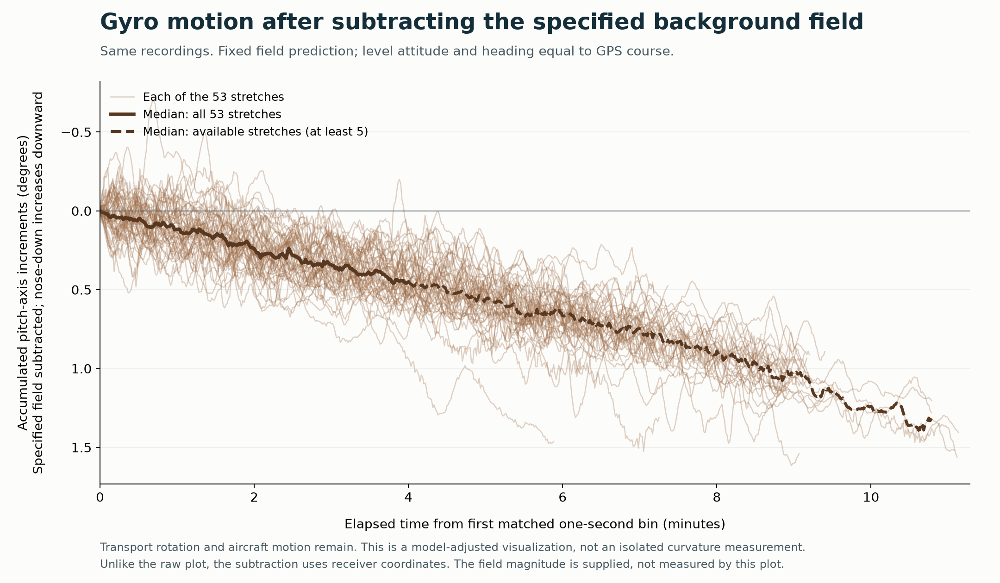

# Local Level Lab

**Testing Earth’s curvature with airborne lidar survey measurements.**

An aircraft following a level path over a globe must gradually change direction
as “down” changes along its route. At 900 km/h, the predicted change is about
eight degrees per hour. A flat path predicts different motion.

An **IMU (inertial measurement unit)** contains gyroscopes and accelerometers.
**The gyroscopes record angular motion of the aircraft-mounted instrument,**
including aircraft turns and any background angular motion. Accelerometers help
reconstruct its motion. A separate GPS receiver supplies the route, speed and
time. The analysis checks which proposed geometry best accounts for all of these
measurements. The data, method and results are open.

## What the measurements show

<!-- current-status:start -->
**53 with the specified-field globe preferred, 0 flat-disc preferences, 0 without a consistent preference** among 53 selected stretches.
See the [verified current status](docs/CURRENT_STATUS.md) for coverage, background-field comparisons and the numerical checks recorded for each cohort.
<!-- current-status:end -->

The original run completed 12 comparisons. Later numerical studies completed
the other 41 using the same stretches and a series of different numerical checks.
The stretches span 27 recording dates. Forty-nine are concentrated between
about 57°S and 64°S, and some share a flight or instrument.

**All 53 raw traces finish nose-down.** Each thin line adds the recorded turns
around the aircraft's pitch axis; the thick line is the median. The graph uses
no GPS values or fitted corrections. Aircraft maneuvers and background angular
motion also contribute, so this picture alone does not decide Earth’s shape.
[Graph explanation and data](docs/ilvis0-gyro-overview/README.md).

**All 53 still finish nose-down after a specified background angular rate is
subtracted.** This correction uses GPS latitude and direction; it is a useful
view of the data, not a free measurement of that rate.
[Correction and data](docs/ilvis0-background-subtracted/README.md).

**All 52 traces with a complete maneuver estimate still finish nose-down after
that estimate is removed.** This illustration uses the instrument’s fused
navigation attitude. That solution already uses the gyros and a globe navigation
model, so the correction shares those assumptions.
[Correction and omitted stretch](docs/ilvis0-motion-subtracted/README.md).

**[See all 53 stretches](docs/ilvis0-current-findings-20261015/STRETCHES.md)** —
instrument configuration, duration, speed, course, latitude and current result.
**[Download the comprehensive CSV](docs/ilvis0-current-findings-20261015/stretch-analytics.csv)**
for measured rate summaries, velocities, model predictions, fit costs, stopping
reasons and shared-track identifiers; [column definitions](docs/ilvis0-current-findings-20261015/ANALYTICS.md)
explain which quantities are measurements and which are diagnostics.

## Where the data come from

NASA’s Operation IceBridge aircraft carried survey-grade Applanix IMUs and GPS
receivers for lidar mapping of ice sheets, glaciers and sea ice. Measuring the
surface accurately requires knowing where the aircraft was and how it was oriented.
These recordings are source material for that work.

The analysis uses the recorded IMU increments and positions from the primary
GPS receiver. It does not use the instrument’s finished navigation answer as
independent evidence.

## How the comparison works

1. **Apply the published selection rules.** Each chosen stretch
   has complete, usable measurements for at least four minutes and a GPS ground
   speed of at least 700 km/h throughout. The selected set was fixed for its own
   fits after earlier exploratory archive fitting.
2. **Make the same comparison on each stretch.** The software reconstructs the
   flight from IMU measurements under a globe with a specified background
   angular field, a globe with no such field, and a stationary flat disc. It
   gives each candidate the same permitted instrument corrections.
3. **Declare the instrument assumptions.** Each fitted gyro axis can have
   a constant offset of up to ±1°/hour. This is an assumed limit. The analysis
   also tests two assumptions about possible onboard subtraction of the field.
4. **Compare the fitted models.** The shape rule compares the stationary
   disc with the better of the two globe fits. If globe wins, the two globe
   fits are compared for the field result.

The **specified field** is an angular-rate pattern supplied to the calculation;
this test does not estimate its rate freely. The GPS receiver reports latitude,
longitude and height using WGS84, a standard geographic coordinate reference.
The comparison therefore has stated coordinate assumptions. The [method page](docs/METHODOLOGY.md)
explains how the recorded IMU and receiver streams are kept separate.

The globe with the specified field fits best in all 53 stretches under both
processing assumptions. Comparing only the zero-field models, the disc fits
better than the globe in 18 stretches under both assumptions. The next controls
will test how much of the separation comes from curvature, the supplied field
and the gyro offset limit. Statistical confidence for aircraft remains open.

## What remains to be checked

In a [four-flight forecast check](docs/ilvis0-measurement-contribution/MATCHED_FOUR_GROUP_AUDIT_RESULT.md),
the specified-field globe predicted unseen GPS positions more closely
than the matched disc on all four flights and met the fixed accuracy
limits on three. Where both zero-field fits completed, the globe also had
lower total position error on all three flights. Statistical confidence
across independent flights remains open.

In a separate airborne archive, an [earlier-only forecast](docs/prediction-observed-development/ROLLING_ORIGIN_400_CONDITIONAL_RESULT.md)
had a raw horizontal RMS error of 5.38 m on one development recording.
Conditioning on earlier receiver errors gave 0.56 m horizontal and 0.17 m
height RMS. A [matched three-model follow-up](docs/prediction-observed-development/ESA_400_120_MODEL_MATRIX_INTERPRETATION.md)
on that same recording favors globe geometry in two complete settings; two
other settings remain unresolved because flat-model fits did not converge.
On another window from the same flight, [two solvers agreed on all 16 matched
globe comparisons](docs/mixed-tangent-hybrid/OBSERVED_DISPATCH_FRESH_RESULT.md).
The aircraft prediction-error range remains open. A [GPS-only screen](docs/external-imu-data/ESA_CONFIRMATION_RECEIVER_INVENTORY_RESULT.md)
found possible test windows in all seven flight groups reserved for confirmation.
Each has a [20-minute slice with complete IMU timestamps](docs/external-imu-data/ESA_CONFIRMATION_TIMING_RESULT.md).

Next, test what the gyroscope adds beyond GPS and acceleration and compare the
two geometries under the same field assumptions. [Plain-language next steps](docs/NEXT_STEPS.md).

- **[Studies at a glance](docs/STUDY_GUIDE.md)** — what each major stage added.
- **[Full study record](docs/STUDIES.md)** — the detailed research history.
- **[How the method works](docs/METHODOLOGY.md)** — observations, models and checks.
- **[Reproduce the studies](docs/REPRODUCIBILITY.md)** — shared code and verified historical evidence.
- **[Archive and instrument guide](docs/ILVIS0.md)** — source data, decoding and provenance.

## A separate ground experiment

A crowdsourced experiment is under development: place a smaller IMU on a solid,
level surface, record, reverse it by 180° and repeat. The aim is to measure a signed
horizontal rotation signal at different latitudes without giving the analyzer an
expected rate. Consumer-device sensitivity still needs testing.
See the [ground experiment](docs/STATIONARY.md) and [participant instructions](docs/PROTOCOL.md).

[Developer setup](docs/DEVELOPMENT.md) · [Contributing](CONTRIBUTING.md) ·
[Privacy](PRIVACY.md) · [Data licensing](DATA_LICENSE.md).
Code: AGPL-3.0-or-later. An [Ars Astronomica](https://arsastronomica.com) project.
