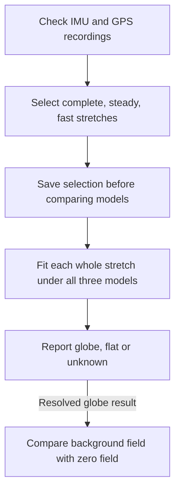

# Local Level Lab

**What do aircraft motion measurements reveal about Earth's shape and a background
rotation field?**

Local Level Lab analyzes NASA airborne survey recordings to investigate that question.
The data come from professional inertial equipment and GPS receivers aboard research aircraft.
A simpler, stationary crowdsourced experiment using smaller, less expensive IMUs is secondary work.
The code, selection criteria and analysis records are open for review.

**The first completed study found 12 stretches that consistently favor globe
geometry over the specified flat disc. No completed comparison favors flat.**
This is a substantial empirical finding from professional airborne measurements.
The qualified recovery trial adds three globe preferences, bringing the current
combined findings to **15 globe, zero flat and 38 unresolved**. Completing the
remaining comparisons is the current priority. [Current findings and source tracks](docs/ilvis0-position-stability-trial-20261013/FINDINGS.md)
are available for review.

**The opportunity is to test Earth's curvature through the aircraft's measured motion.**
Professional IMU recordings let anyone examine the gradual turning expected while
crossing a curved surface, and compare competing explanations against the same data.
The contribution is an open, reproducible airborne test of competing geometries.
It builds on a long tradition of measuring Earth's figure, including Snellius's
1617 survey ([English translation](https://arsastronomica.com/works/willebrord-snellius-eratosthenes-batavus/)).

An **IMU (inertial measurement unit)** measures turning and acceleration. Its gyroscopes
measure how it turns; its accelerometers measure forces associated with gravity and motion.
GPS records where the aircraft went and when.

The project separates **surface geometry**, **measured rotation** and **its physical
explanation**. A gyro measures the sensor's angular motion relative to an inertial
reference—a reference that is not itself turning. Separating aircraft motion from a
persistent background field is an analysis task. Identifying what produces that field
is a further question, which these recordings alone do not settle. This project does
not treat a gyro signal as proof of heliocentrism or any other cosmology.

Earth's shape and its place in the solar system are separate questions. **Geocentric
does not mean flat, and a globe result alone does not establish heliocentrism.**

## The idea

An aircraft staying level over a globe must gradually turn as it follows the curved surface:
the direction of local down changes along its route. At 900 km/h, that curvature corresponds
to roughly eight degrees of turning per hour. A background rotation field would add
a different contribution. The analysis separates these terms from ordinary aircraft
movements and instrument errors.

| Model | Predicted contributions |
|---|---|
| Rotating globe | Globe curvature, the standard background rotation field and aircraft maneuvers. |
| Still globe | Globe curvature and aircraft maneuvers, with no background rotation field. |
| Still flat disc | Aircraft maneuvers and changes of direction around the disc, with no globe curvature or background rotation field. |

**“Rotating globe” and “still globe” are names for these mathematical candidates.**
They compare a specified background angular-rate term with zero. They do not compare
every proposed cause of rotation. A proposed stationary Earth with a nonzero inertial
field is not represented by the zero-field “still globe” candidate. It would need
explicit measurement predictions before it could be tested here.

The first question is **globe, flat or unknown**. All three models are fitted together,
comparing the flat model with whichever globe model fits better. The background-field
comparison is reported only after shape consistently favors a globe; it reuses the globe fits.

A persistent gyro reading alone proves little. Instrument offsets, aircraft motion and
uncertain onboard corrections can imitate parts of the signal. Those effects must be
allowed fairly across all models. This tests the specified models, rather than every
possible description of a flat Earth.

## Primary work: NASA airborne data

These recordings supported NASA's Operation IceBridge lidar surveys of ice sheets,
glaciers and sea ice. LVIS, the Land, Vegetation, and Ice Sensor, measures laser returns
from the surface. GPS locates the aircraft and the IMU tracks its orientation so those
returns can become accurately positioned elevation maps. See [NASA's LVIS description](https://lvis.gsfc.nasa.gov/Home/index.html).

The raw recordings are source material underlying those finished survey products.
Reliable survey maps depend on reliable measurements, calibration and processing. This
project uses the archived IMU measurements themselves to compare Earth models, rather
than using the survey's finished navigation answer as evidence.

The ILVIS0 archive contains **survey-grade Applanix IMU recordings with embedded GPS**.
These instruments were built for precision airborne mapping and are far more capable
than phone IMUs. Their published capabilities make slow turning at degrees per hour a
credible measurement target. The reference instrument is a POS AV 510; other recorded
configurations are decoded and assessed separately.

The analysis preserves original measurements and timestamps, checks packet integrity,
and verifies units against the instrument's combined GPS/IMU navigation output. That
combined output supplies decoder checks and motion context, rather than independent
evidence about Earth's shape. The model fits use IMU increments and receiver positions.

**The GPS positions come from the primary receiver's own recorded stream, separately
from the combined IMU/GPS navigation solution.** Applanix's
[interface specification](https://asapdata.arc.nasa.gov/share/ASF_Applanix/POSv6_User_ICD.pdf#page=71)
identifies this as Group 10001. This avoids testing the instrument's finished navigation
answer against itself. GPS latitude, longitude and height still use geodetic coordinate
conventions, and the analysis assigns a declared geometry to each candidate. It is an
explicit comparison of models with separate measurement streams, rather than a
model-free measurement of curvature. The [archive guide](docs/ILVIS0.md#measurement-provenance-and-independence)
explains the distinction and the checks planned to isolate the IMU's contribution.

Here, **raw** means the recorded angle and velocity increments, before the finished
navigation solution. It does not mean that the electronics applied no calibration or
filtering. Ordinary noise filtering can preserve slow turning. Automatic zeroing or
subtracting a presumed background rotation can remove it, so the analysis also tests
possible upstream Earth-rate removal. Passing a numerical fit does not identify which onboard processing
was used.

The current selection requires **four continuous minutes** with every supported GPS
ground-speed reading at least **700 km/h**, plus limits on aircraft motion, gaps and
instrument changes. Selection is fixed before examining model preferences. Each whole
stretch is fitted jointly; shorter sections check consistency without becoming extra
flights or receiving separate calibration fits.

The [public selection record](docs/ilvis0-highspeed-segments-20261008/ELIGIBILITY.md)
links to every eligible interval and every file's screening outcome.
The [complete table of all 53 stretches](docs/ilvis0-position-stability-trial-20261013/STRETCHES.md)
lists source recordings, dates, durations, speeds, courses, latitudes and current dispositions.
See the [methodology](docs/METHODOLOGY.md) for the reasoning and the
[archive guide](docs/ILVIS0.md) for instruments, decoding and remaining uncertainties.

A planned [rotation-field follow-up](docs/ROTATION_FIELD.md) will measure the background
rotation freely before interpreting its cause. With longer records and sufficient precision,
it will also test whether the measured rate distinguishes a sidereal day from a 24-hour
solar day: about **15.0411 versus 15.0000 degrees/hour**. That small difference needs
separate calibration and timing checks; the current short-stretch results do not resolve it.

## Current status

- **Coverage:** all 232 retained recordings have been screened. The first full run
  analyzed 53 eligible stretches, totaling 424.3 minutes.
- **Shape:** the preserved first study found 12 complete globe preferences. The
  qualified recovery trial adds three: **15 globe, zero flat, 38 unresolved**.
  Unfinished comparisons are not evidence for either shape.
- **Background rotation:** all 15 resolved stretches favor the specified rotation
  field over zero field. Its physical cause and a solar-versus-sidereal distinction
  have not been determined.
- **Current priority:** complete the remaining comparisons using the qualified
  actual-position stability check. Its trial passed **24/24 fits**, including all
  controls and repeats. The [wider recovery run](docs/ilvis0-position-recovery-20261013/README.md)
  permits 159 new starts, reuses qualified results and keeps the physical assumptions fixed.
  Earlier results and the completed timing, calibration and prediction checks remain preserved.
- **Instrument coverage:** completed comparisons now include both recorded IMU8
  and IMU21 configurations, decoded separately under the same analysis rules.

The completed findings are substantial, but a validated statistical significance
level has not yet been established. Some recordings overlap or share instruments,
so the stretches cannot simply be counted as independent confirmations.

See [current findings and source tracks](docs/ilvis0-position-stability-trial-20261013/FINDINGS.md),
[how the method works](docs/METHODOLOGY.md),
[method development and robustness checks](docs/METHODOLOGY_DEVELOPMENT.md), and
[the next steps](docs/ANALYSIS_ROADMAP.md).

## Secondary work: a stationary crowdsourced experiment

**Can people recover the same horizontal rotation field with independently owned IMUs
at different latitudes?** This experiment keeps the IMU on a solid, level surface.

Point a marked horizontal sensor axis approximately toward true north, record without
touching it, then turn it 180° with the same face up and record again. An external
horizontal rate changes sign; a constant sensor offset stays on the same axis.
Repeated A–B–B–A blocks help separate a steadily changing offset.

The Android app guides these still blocks and saves original IMU data, timing,
device information and participant-entered location/alignment. It needs no aircraft,
flight details or continuous GPS. The initial setting is 30 minutes per block,
about four hours for eight blocks; this is a development setting, not a guaranteed
minimum. A simple holder with two opposite stops can make reversals repeatable.

The analyzer estimates a **signed reversal rate without using latitude or an expected
rotation value**. A later geographic analysis would compare those estimates with
cos(latitude), fitting the amplitude rather than assuming 15 degrees/hour. This
tests the measured field before interpreting its cause. It does not establish Earth's
shape on its own. [Why the horizontal component depends on latitude](https://www.vectornav.com/resources/inertial-navigation-primer/theory-of-operation/theory-gyros).

The collection flow and preliminary diagnostic are implemented. Real consumer-device
sensitivity, temperature behavior, alignment and uncertainty still need testing;
geographic pooling and detection thresholds are not yet implemented. Longer averaging
does not remove every systematic error or restore a signal erased by automatic zeroing.
NASA results do not certify consumer IMUs.

See the [stationary method](docs/STATIONARY.md), [simple participant protocol](docs/PROTOCOL.md),
[instrument checks](docs/BENCH.md) and [validation plan](docs/VALIDATION.md).
Public upload requires consent; read the [privacy policy](PRIVACY.md).

## Explore or contribute

[Developer setup](docs/DEVELOPMENT.md) covers the app, Python analysis and upload server.
[Contributing](CONTRIBUTING.md) explains how to help. Reviews of the physics, statistics,
instrument behavior and explanations are welcome.

Code uses AGPL-3.0-or-later. Published participant recordings use CC0; third-party data
retain their own terms. See [data licensing](DATA_LICENSE.md).
Local Level Lab is an [Ars Astronomica](https://arsastronomica.com) project.
