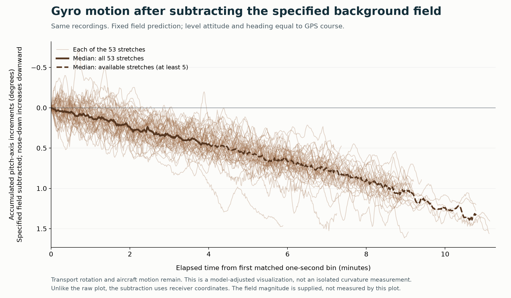
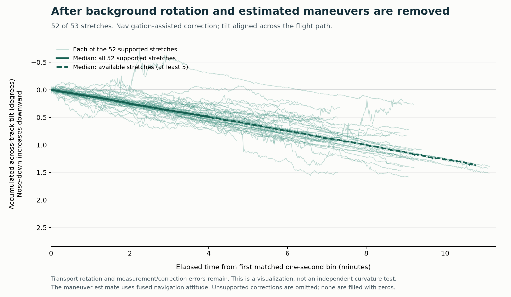

# Local Level Lab

**Testing Earth’s curvature with airborne lidar survey measurements.**

An aircraft flying level over a globe gradually turns as the direction of local down
changes along its route. At 900 km/h, following that curve means about eight degrees
of turning per hour. That is a measurable prediction.

An **IMU (inertial measurement unit)** contains gyroscopes and accelerometers.
**The central measurement is the gyroscope record: how the aircraft actually turns.**
Accelerometers help reconstruct its motion; GPS supplies route, speed and timing.
Local Level Lab tests those recorded movements against globe and flat-disc predictions.
The measurements, code and results are open.

## What the measurements show

<!-- current-status:start -->
**53 globe preferences, 0 flat preferences, 0 unresolved** among 53 preselected stretches.
See the [verified current status](docs/CURRENT_STATUS.md) for coverage, background-field comparisons and the supporting result records. All selected comparisons have passed their required numerical checks.
<!-- current-status:end -->

The original run completed twelve comparisons; the other 41 passed separately
checked numerical recoveries. Every result uses the same preselected observations.

**The recorded motion has a consistent direction: all 53 traces finish nose-down.**
Each thin line sums the raw gyro increments around the aircraft's pitch axis,
starting at zero; the thick line shows the median. No fitted corrections or GPS
values enter these angles. The graph includes every selected stretch.

This is a direct visualization of the measurements, not a separate curvature test:
aircraft motion and the background rotation field also contribute. The full analysis
accounts for those contributions when comparing shapes.
[How to read the graph and download its data](docs/ilvis0-gyro-overview/README.md).

**Subtracting the specified background field leaves all 53 traces ending
nose-down.** This uses the same gyro bins, but the correction uses GPS latitude
and direction with an assumed level attitude. Aircraft motion remains; the
background rate is supplied rather than measured by this plot.
[What was subtracted, and the plotted data](docs/ilvis0-background-subtracted/README.md).

**After estimated aircraft maneuvers are also removed, all 52 supported traces
finish nose-down.** This uses fused navigation attitude to estimate maneuvers
and aligns tilt across the flight path. One stretch lacks a complete saved
correction. Transport rotation and correction errors remain: this visualization
is separate from the research tests.
[How the correction works and which stretch is omitted](docs/ilvis0-motion-subtracted/README.md).

A [route-based companion](docs/ilvis0-gyro-companion-v2/INTERPRETATION.md) compares
these raw rates with geographic predictions, without fitting gyro corrections.
Median rate differences are **0.88°/h for globe plus the specified field,
2.84°/h for zero-field globe, and 5.87°/h for the level flat prediction**.
Aircraft motion remains in this descriptive comparison.

A [three-recording prediction pilot](docs/ilvis0-retrospective-prediction-pilot-v2/INTERPRETATION.md)
calibrated on earlier measurements and checked later GPS positions without
using them to adjust the answer. One recording completed all required settings:
horizontal RMS was **0.84–1.13 m for globe plus the specified field, about 496 m
for zero-field globe and 793 m for disc**. The other two recordings have missing
fits or failed accuracy checks. These are development results; statistical
confidence and independent confirmation remain open.

Separate [height-removal checks](docs/ilvis0-measurement-contribution/README.md)
preserve the horizontal score advantage, but allow unrealistic vertical paths.
One of two refitted stretches passed every repeat check; the other remains
unresolved after a matched timing search. These test what drives the result;
they do not replace the complete 53-stretch analysis.

**[See all 53 stretches](docs/ilvis0-current-findings-20261015/STRETCHES.md)** —
instrument configuration, duration, speed, course, latitude and current result.
**[Download the comprehensive CSV](docs/ilvis0-current-findings-20261015/stretch-analytics.csv)**
for measured rate summaries, velocities, model predictions, fit costs, stopping
reasons and shared-track identifiers; [column definitions](docs/ilvis0-current-findings-20261015/ANALYTICS.md)
explain which quantities are measurements and which are diagnostics.

## Where the data come from

NASA’s Operation IceBridge aircraft carried survey-grade Applanix IMUs and GPS
receivers for lidar mapping of ice sheets, glaciers and sea ice. Measuring the
surface accurately requires knowing where the aircraft was and how it was oriented.
These recordings are source material for that work.

The analysis works from the recorded IMU increments, rather than treating the
instrument’s finished navigation answer as evidence.

## Gyroscope measurements, GPS context

GPS locates the flight so each model can predict the turning associated with its
route. Receiver positions also constrain the reconstructed track during fitting.
**GPS is the positioning system; WGS84 is the coordinate reference used for its
reported positions.** Those conventions remain part of the analysis. The ongoing
[measurement-contribution checks](docs/NEXT_STEPS.md#then-strengthen-the-interpretation)
test what the gyro adds beyond the receiver positions, acceleration and declared
physical assumptions, including cases that cannot distinguish the models.

Select steady, complete stretches of at least four minutes and 700 km/h throughout,
**before examining model preferences**. Fit each whole stretch with the same permitted
instrument errors under globe-with-field, zero-field globe and stationary flat-disc
candidates. Compare shape first, then the background field.

The completed comparisons are substantial evidence favoring the globe in this test.
A statistical significance level has not yet been calibrated, and overlapping
recordings cannot be counted as independent flights.

Earth’s shape, a measured rotation field and the cause of that field are separate
questions. A globe result does not decide geocentrism versus heliocentrism. The
current background-field comparison neither identifies its cause nor measures a
solar-versus-sidereal rate difference.

## Follow the work

The [prediction pilot](docs/ilvis0-retrospective-prediction-pilot-v2/INTERPRETATION.md)
now succeeds on one complete recording-level comparison. A separate
[ESA development comparison](docs/esa-observed-wide-pilot/INTERPRETATION.md) now
completes three matched settings: typical later 3D position error is **about
15 m for globe plus the specified field, 3.8–4.4 km for zero-field globe and
7.4–8.6 km for disc**. These reuse one twenty-minute recording; the fourth
setting is incomplete because two starts reached the runtime ceiling.
The [corrected solver](docs/timing-matrix-combined/README.md) now passes all
48 development cases and 24 comparisons between prescribed starting points,
under the original limits. Earlier failed runs remain recorded. A
[fresh calibration campaign is running](docs/FEASIBLE_PREDICTION_STATUS.md)
on simulated measurements; separate validation follows only if calibration
qualifies. No validated uncertainty threshold is available yet.
Statistical confidence is tested separately; independent ESA confirmation
follows method qualification. Shared recordings are grouped
before validation; ESA recording 187 is development material and the other
cataloged groups are reserved for confirmation. A freely measured rotation
field and solar-versus-sidereal precision come later.

- **[Studies and what each added](docs/STUDIES.md)** — a concise guide to the analyses,
  successful recoveries and approaches that did not qualify.
- **[How the method works](docs/METHODOLOGY.md)** — observations, models and checks.
- **[Reproduce the studies](docs/REPRODUCIBILITY.md)** — shared code and verified historical evidence.
- **[What comes next](docs/NEXT_STEPS.md)** — measurement contributions,
  withheld predictions, protected ESA confirmation and later rotation-field work.
- **[Archive and instrument guide](docs/ILVIS0.md)** — source data, decoding and provenance.

## A separate ground experiment

A crowdsourced experiment is under development: place a smaller IMU on a solid,
level surface, record, reverse it by 180° and repeat. The aim is to measure a signed
horizontal rotation signal at different latitudes without giving the analyzer an
expected rate. Consumer-device sensitivity still needs testing.
See the [ground experiment](docs/STATIONARY.md) and [participant instructions](docs/PROTOCOL.md).

[Developer setup](docs/DEVELOPMENT.md) · [Contributing](CONTRIBUTING.md) ·
[Privacy](PRIVACY.md) · [Data licensing](DATA_LICENSE.md).
Code: AGPL-3.0-or-later. An [Ars Astronomica](https://arsastronomica.com) project.
