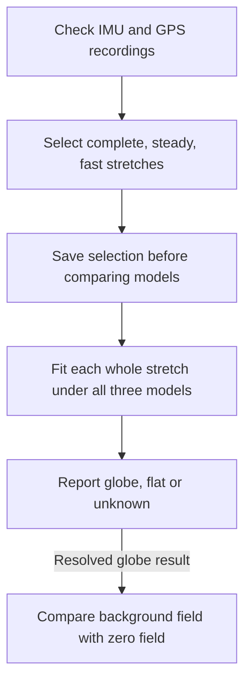

# Local Level Lab

**What do aircraft motion measurements reveal about Earth's shape and a background
rotation field?**

Local Level Lab analyzes NASA airborne survey recordings to investigate that question.
The data come from professional inertial equipment and GPS receivers aboard research aircraft.
A simpler, stationary crowdsourced experiment using smaller, less expensive IMUs is secondary work.
The code, selection criteria and analysis records are open for review.

**The first completed study found 12 stretches that consistently favor globe
geometry over the specified flat disc. No completed comparison favors flat.**
This is a substantial empirical finding from professional airborne measurements.
Another 41 eligible stretches have unfinished numerical comparisons; recovering
them is the current priority. [Results and source tracks](docs/ilvis0-highspeed-segments-20261008/FINDINGS.md)
are available for review.

**The opportunity is to test Earth's curvature through the aircraft's measured motion.**
Professional IMU recordings let anyone examine the gradual turning expected while
crossing a curved surface, and compare competing explanations against the same data.
The contribution is an open, reproducible airborne test of competing geometries.
It builds on a long tradition of measuring Earth's figure, including Snellius's
1617 survey ([English translation](https://arsastronomica.com/works/willebrord-snellius-eratosthenes-batavus/)).

An **IMU (inertial measurement unit)** measures turning and acceleration. Its gyroscopes
measure how it turns; its accelerometers measure forces associated with gravity and motion.
GPS records where the aircraft went and when.

The project separates **surface geometry**, **measured rotation** and **its physical
explanation**. A gyro measures the sensor's angular motion relative to an inertial
reference—a reference that is not itself turning. Separating aircraft motion from a
persistent background field is an analysis task. Identifying what produces that field
is a further question, which these recordings alone do not settle. This project does
not treat a gyro signal as proof of heliocentrism or any other cosmology.

Earth's shape and its place in the solar system are separate questions. **Geocentric
does not mean flat, and a globe result alone does not establish heliocentrism.**

## The idea

An aircraft staying level over a globe must gradually turn as it follows the curved surface:
the direction of local down changes along its route. At 900 km/h, that curvature corresponds
to roughly eight degrees of turning per hour. A background rotation field would add
a different contribution. The analysis separates these terms from ordinary aircraft
movements and instrument errors.

| Model | Predicted contributions |
|---|---|
| Rotating globe | Globe curvature, the standard background rotation field and aircraft maneuvers. |
| Still globe | Globe curvature and aircraft maneuvers, with no background rotation field. |
| Still flat disc | Aircraft maneuvers and changes of direction around the disc, with no globe curvature or background rotation field. |

**“Rotating globe” and “still globe” are names for these mathematical candidates.**
They compare a specified background angular-rate term with zero. They do not compare
every proposed cause of rotation. A proposed stationary Earth with a nonzero inertial
field is not represented by the zero-field “still globe” candidate. It would need
explicit measurement predictions before it could be tested here.

The first question is **globe, flat or unknown**. All three models are fitted together,
comparing the flat model with whichever globe model fits better. The background-field
comparison is reported only after shape consistently favors a globe; it reuses the globe fits.

A persistent gyro reading alone proves little. Instrument offsets, aircraft motion and
uncertain onboard corrections can imitate parts of the signal. Those effects must be
allowed fairly across all models. This tests the specified models, rather than every
possible description of a flat Earth.

## Primary work: NASA airborne data

These recordings supported NASA's Operation IceBridge lidar surveys of ice sheets,
glaciers and sea ice. LVIS, the Land, Vegetation, and Ice Sensor, measures laser returns
from the surface. GPS locates the aircraft and the IMU tracks its orientation so those
returns can become accurately positioned elevation maps. See [NASA's LVIS description](https://lvis.gsfc.nasa.gov/Home/index.html).

The raw recordings are source material underlying those finished survey products.
Reliable survey maps depend on reliable measurements, calibration and processing. This
project uses the archived IMU measurements themselves to compare Earth models, rather
than using the survey's finished navigation answer as evidence.

The ILVIS0 archive contains **survey-grade Applanix IMU recordings with embedded GPS**.
These instruments were built for precision airborne mapping and are far more capable
than phone IMUs. Their published capabilities make slow turning at degrees per hour a
credible measurement target. The reference instrument is a POS AV 510; other recorded
configurations are decoded and assessed separately.

The analysis preserves original measurements and timestamps, checks packet integrity,
and verifies units against the instrument's combined GPS/IMU navigation output. That
combined output supplies decoder checks and motion context, rather than independent
evidence about Earth's shape. The model fits use IMU increments and receiver positions.

**The GPS positions come from the primary receiver's own recorded stream, separately
from the combined IMU/GPS navigation solution.** Applanix's
[interface specification](https://asapdata.arc.nasa.gov/share/ASF_Applanix/POSv6_User_ICD.pdf#page=71)
identifies this as Group 10001. This avoids testing the instrument's finished navigation
answer against itself. GPS latitude, longitude and height still use geodetic coordinate
conventions, and the analysis assigns a declared geometry to each candidate. It is an
explicit comparison of models with separate measurement streams, rather than a
model-free measurement of curvature. The [archive guide](docs/ILVIS0.md#measurement-provenance-and-independence)
explains the distinction and the checks planned to isolate the IMU's contribution.

Here, **raw** means the recorded angle and velocity increments, before the finished
navigation solution. It does not mean that the electronics applied no calibration or
filtering. Ordinary noise filtering can preserve slow turning. Automatic zeroing or
subtracting a presumed background rotation can remove it, so the analysis also tests
possible upstream Earth-rate removal. Passing a numerical fit does not identify which onboard processing
was used.

The current selection requires **four continuous minutes** with every supported GPS
ground-speed reading at least **700 km/h**, plus limits on aircraft motion, gaps and
instrument changes. Selection is fixed before examining model preferences. Each whole
stretch is fitted jointly; shorter sections check consistency without becoming extra
flights or receiving separate calibration fits.

The [public selection record](docs/ilvis0-highspeed-segments-20261008/ELIGIBILITY.md)
links to every eligible interval and every file's screening outcome.
See the [methodology](docs/METHODOLOGY.md) for the reasoning and the
[archive guide](docs/ILVIS0.md) for instruments, decoding and remaining uncertainties.

A planned [rotation-field follow-up](docs/ROTATION_FIELD.md) will measure the background
rotation freely before interpreting its cause. With longer records and sufficient precision,
it will also test whether the measured rate distinguishes a sidereal day from a 24-hour
solar day: about **15.0411 versus 15.0000 degrees/hour**. That small difference needs
separate calibration and timing checks; the current short-stretch results do not resolve it.

## Current status

**All 12 completed whole-stretch comparisons favor globe geometry under both
processing assumptions; none favors the specified flat disc.** The consistent
result is substantial on its own. The analysis attempted all 53 selected stretches;
41 comparisons remain numerically unfinished.

The 12 completed comparisons also favor the globe candidate containing the standard
background rotation term over the zero-field globe. This separate result compares
observable predictions; it does not identify the physical cause of that field.

- All **232 retained files** have been screened: **53 qualifying stretches, totaling
  424.3 minutes**. Some instrument streams overlap; these are not 53 independent flights.
- **12 stretches favor globe over flat under both processing assumptions.** All 12 also
  favor the background-field globe over the zero-field globe. None has a resolved flat preference; 41 remain unknown
  because required calculations did not pass the numerical stopping checks.
  [Findings and source data](docs/ilvis0-highspeed-segments-20261008/FINDINGS.md) explain
  the complete and partial comparisons and link to every source recording and track.
- **The pilot's resolved comparisons favor globe.** Two recordings favored globe over
  flat, then the background-field globe over the zero-field globe, under all four tested cases. Two other recordings
  have globe-favoring partial shape comparisons; two have no completed shape comparison.
  **None of the six has a resolved preference for flat.**
  [Provisional pilot findings](docs/ilvis0-refinement-20261008/PROVISIONAL.md) explain the results.
- The larger analysis tests two processing assumptions: the background rotation was retained
  in the logged measurements, or a shared amount may have been removed onboard.
  Both allow a constant gyro offset of ±1 degree/hour. This is the analysis's offset
  allowance; it is not a claim that these instruments drift by that amount.

**Converged** means the solver satisfied numerical stopping and stationarity checks.
It measures whether a calculation finished, not whether its model matched the data well.
A flat-disc calculation can converge while fitting the flight much worse than a globe.
The 41 unknown results mean **the comparison could not be completed**, not that globe
and flat received equal support. Missing calculations are not evidence for either shape.

**A substantial finding is different from an established statistical significance
level.** The study has not yet assigned a validated significance level. Some
recordings share flight time or instruments, so twelve completed stretches are
not automatically twelve independent replications. The remaining checks assess
the finding's robustness and uncertainty; they do not erase the completed comparisons.

The [saved-result diagnosis](docs/ilvis0-highspeed-segments-20261008/POST_RUN_REVIEW.md)
found that most unresolved calculations exhausted their numerical allowance. The
[small matched solver trial](docs/ilvis0-solver-trial-20261010/README.md) is complete:
10 of its 12 fits finished, compared with 11 previously. It preserved the control's
globe and rotation preference but did not improve completion.

The [calibration and fit-quality audit](docs/ilvis0-calibration-audit-20261010/README.md)
compares the same 12 resolved stretches under both processing cases. Median horizontal
track mismatch is **0.068 m for rotating globe, 29.5 m for still globe and 47.1 m for
flat disc**, using each model's declared coordinate metric. The audit also identifies
weak Z-axis calibration directions and the residual checks still needed.

A [two-recording residual diagnostic](docs/ilvis0-residual-diagnostic-20261010/README.md)
now reproduces the saved errors without refitting. Rotating-globe errors remain much
smaller, but show temporal correlation. Changing the integration clock at the same
parameters raises vertical error from about 0.6–0.7 m to about 9.2–9.4 m. The report
plots those errors and explains why timing needs a matched test next.

The [software qualification checks](docs/ilvis0-solver-qualification-20261010/README.md)
passed all 34 predefined starts, including short analytic IMU/GPS controls. These check
known numerical answers; they add no real-flight evidence. A small comparison that
refits the completed control under packet-header timing has finished: all six fits
converged and preserved the globe and rotation preference. Calibration readjustment
restored its rotating-globe vertical error to about 0.70 m. Z-axis calibration limits
still need investigation.

The [clock/calibration audit](docs/ilvis0-clock-calibration-audit-20261011/README.md)
shows which estimates changed: gravity correction moved away from its limit, while
Z-axis gyro gain and offset stayed at theirs. A
[12-fit sensitivity comparison](docs/ilvis0-calibration-trial-20261011/README.md)
has finished with 11 fits converged. Fixing Z gain to zero preserved the globe and
rotation preference under both processing cases. Fixing Z offset to zero left one
still-globe fit unfinished; that comparison remains unresolved. Rotating-globe
track errors stayed close to the original values in both tests.

The [integration follow-up](docs/ilvis0-integration-audit-20261011/README.md) tested
a calculation that accounts for motion within each recorded interval. It completed
four of six fits and left the Z-axis calibration corrections at the same limits.
It has not improved the original method enough to replace it.

The [joint Z-axis calibration grid](docs/ilvis0-z-profile-audit-20261011/README.md)
has now completed **all 27 fits**. On the same 438-second recording, every tested
combination of Z gyro gain (−2%, zero, +2%) and constant offset (−1, zero,
+1 degree/hour) favors globe, then the specified background field. Horizontal
track errors range from **0.081–0.093 m for the background-field globe**, versus
**29.0–29.6 m for zero-field globe** and **63.6–64.1 m for the disc**. The preferred
fit needs at most one remaining parameter at its limit. Its advantage does not
depend on the two extreme Z corrections, although the grid does not identify their
true calibration. These are repeated checks on one recording, not 27 new flights.

Both bounded follow-ups are now complete. Allowing
[possible onboard field removal](docs/ilvis0-z-profile-removal-20261011/RESULTS.md)
finished all 27 fits and preserved globe preference at every grid point, then the
specified background-field preference. The
[preselected September 24 recording](docs/ilvis0-z-profile-replication-20261011/RESULTS.md)
finished 25 of 27 fits. Its seven complete comparisons favor globe; two remain
unfinished. The full-grid background-field conclusion is withheld. These checks
preserve the original analysis; they add no independent statistical calibration.

The [follow-up audit](docs/ilvis0-z-followup-audit-20261012/README.md) compares all
81 saved fits. Both unfinished September 24 fits have small track errors and pass
the saved stationarity check, but reached their evaluation cap without solver-reported
success. They remain unfinished. The preferred model on the first recording changes
very little when onboard field removal is allowed; its fitted removal fraction stays
essentially zero.

The [residual correlation audit](docs/ilvis0-residual-covariance-20261012/README.md)
examines those saved errors across time and axes. On October 5, vertical errors remain
correlated even a minute apart after the current uncertainty adjustment; September 24
shows less slow correlation. This leaves the model preferences unchanged, but explains
why small errors alone do not establish reliable uncertainty estimates. A shared
error-model plan is ready; it has not replaced the original analysis.
The [prediction uncertainty checks](docs/ilvis0-nonlinear-uncertainty-controls-20261012/README.md)
now cover correlated errors, estimation from training data, nonlinear behavior and
calibration limits. They verify the calculations and expose where simple uncertainty
estimates fail. The [native integration checks](docs/ilvis0-native-uncertainty-controls-20261012/README.md)
also verify all 27 calibration and processing derivatives against independently
constructed paths. The [bounded archive prediction comparison](docs/ilvis0-prediction-covariance-20261012/RESULTS.md)
has finished: 10 of 12 fits converged, leaving the combined comparison unresolved.
The priority is now completing more of the 41 unfinished stretches. A
[recovery qualification trial](docs/ilvis0-convergence-recovery-trial-20261012/README.md)
has finished: all six completed-control fits passed, and eight of 15 unfinished
primary fits were recovered. None of its three test stretches became fully resolved.
A [numerical audit](docs/ilvis0-recovery-diagnosis-20261012/README.md) distinguishes
early stopping from failed stability checks. A different bounded solver passed
30 of 30 software controls and is [running in a separate archival trial](docs/ilvis0-rectangular-recovery-trial-20261012/README.md).
The original findings remain unchanged.

The remaining checks concern numerical completion, fits reaching allowed calibration
limits, and the exact timing and corrections used in the logs. Published hardware
specifications provide useful performance context; these checks determine how confidently
we can quantify the model differences. The current study reports which model fits better,
without assigning a validated statistical significance level. The completed results and
preselected intervals remain preserved.

The [analysis roadmap](docs/ANALYSIS_ROADMAP.md) puts calibration-boundary diagnosis,
absolute fit quality and timing/GPS sensitivity next. Exact device characterization
continues in parallel at lower priority; modeling does not wait for it. A separate
[rotation-field study](docs/ROTATION_FIELD.md) is planned to estimate the background
vector before interpreting its cause.

A field's direction, magnitude and latitude pattern can constrain explanations.
Explanations predicting identical measurements cannot be separated by those measurements
alone. The present study has not freely measured the rotation magnitude or resolved
solar versus sidereal rate; neither result should be inferred from the fixed-rate model label.

## Secondary work: a stationary crowdsourced experiment

**Can people recover the same horizontal rotation field with independently owned IMUs
at different latitudes?** This experiment keeps the IMU on a solid, level surface.

Point a marked horizontal sensor axis approximately toward true north, record without
touching it, then turn it 180° with the same face up and record again. An external
horizontal rate changes sign; a constant sensor offset stays on the same axis.
Repeated A–B–B–A blocks help separate a steadily changing offset.

The Android app guides these still blocks and saves original IMU data, timing,
device information and participant-entered location/alignment. It needs no aircraft,
flight details or continuous GPS. The initial setting is 30 minutes per block,
about four hours for eight blocks; this is a development setting, not a guaranteed
minimum. A simple holder with two opposite stops can make reversals repeatable.

The analyzer estimates a **signed reversal rate without using latitude or an expected
rotation value**. A later geographic analysis would compare those estimates with
cos(latitude), fitting the amplitude rather than assuming 15 degrees/hour. This
tests the measured field before interpreting its cause. It does not establish Earth's
shape on its own. [Why the horizontal component depends on latitude](https://www.vectornav.com/resources/inertial-navigation-primer/theory-of-operation/theory-gyros).

The collection flow and preliminary diagnostic are implemented. Real consumer-device
sensitivity, temperature behavior, alignment and uncertainty still need testing;
geographic pooling and detection thresholds are not yet implemented. Longer averaging
does not remove every systematic error or restore a signal erased by automatic zeroing.
NASA results do not certify consumer IMUs.

See the [stationary method](docs/STATIONARY.md), [simple participant protocol](docs/PROTOCOL.md),
[instrument checks](docs/BENCH.md) and [validation plan](docs/VALIDATION.md).
Public upload requires consent; read the [privacy policy](PRIVACY.md).

## Explore or contribute

[Developer setup](docs/DEVELOPMENT.md) covers the app, Python analysis and upload server.
[Contributing](CONTRIBUTING.md) explains how to help. Reviews of the physics, statistics,
instrument behavior and explanations are welcome.

Code uses AGPL-3.0-or-later. Published participant recordings use CC0; third-party data
retain their own terms. See [data licensing](DATA_LICENSE.md).
Local Level Lab is an [Ars Astronomica](https://arsastronomica.com) project.
