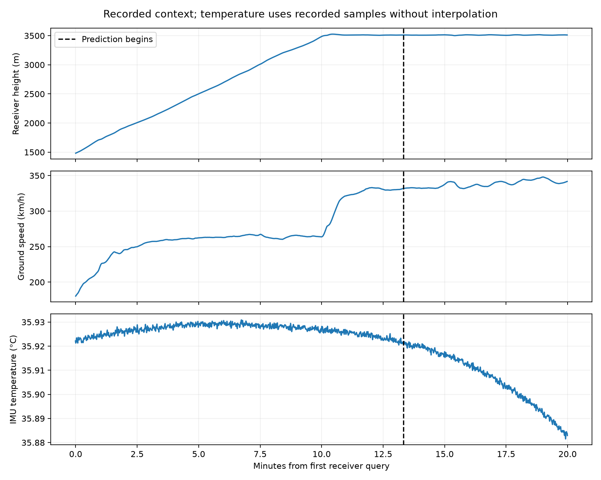
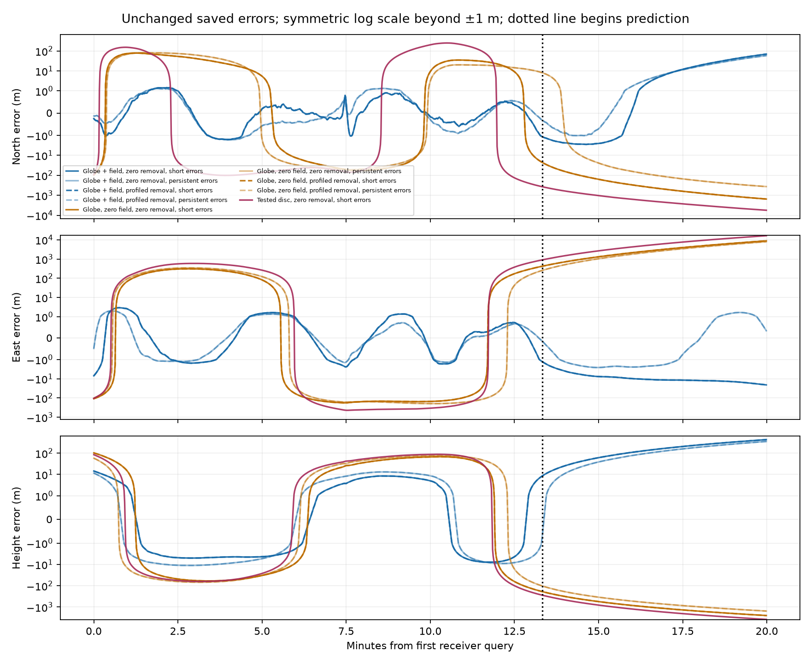

# Diagnosing later-position errors

**9/12 settings have a qualified saved forecast available.** This diagnosis preserves every original prediction and accuracy label. It performs no new fit or propagation.

The reference gravity curve changes by **0.00628917 m/s²** over the recorded height range. Under the declared radial-field sensitivity, its largest later discrepancy from the earlier mean corresponds to a constant-acceleration position scale of **187.1 m**.
That scale is a diagnostic illustration. It is not a predicted error, confidence bound, measured gravity field or established explanation for the observed errors. The same reference applies to every candidate.

| Candidate | Removal | Working errors | Parameters near bounds | Fitted constant gravity | Later horizontal RMS | Later height RMS |
|---|---|---|---:|---:|---:|---:|
| Globe + field | Zero | Short memory | 8 | 9.905592 m/s² | 26.92 m | 211.901 m |
| Globe + field | Zero | Persistent | 4 | 9.901057 m/s² | 21.0445 m | 168.229 m |
| Globe + field | Profiled | Short memory | 9 | 9.905592 m/s² | 26.9201 m | 211.901 m |
| Globe + field | Profiled | Persistent | 5 | 9.901057 m/s² | 21.0445 m | 168.229 m |
| Globe, zero field | Zero | Short memory | 17 | 9.765742 m/s² | 4268.55 m | 1341.77 m |
| Globe, zero field | Zero | Persistent | 17 | 9.765742 m/s² | 3742.52 m | 834.655 m |
| Globe, zero field | Profiled | Short memory | 18 | 9.765742 m/s² | 4268.54 m | 1341.78 m |
| Globe, zero field | Profiled | Persistent | 18 | 9.765742 m/s² | 3742.53 m | 834.653 m |
| Tested disc | Zero | Short memory | 17 | 9.765742 m/s² | 8442.52 m | 2016.18 m |
| Tested disc | Zero | Persistent | Unavailable | Unavailable | Unavailable | Unavailable |
| Tested disc | Profiled | Short memory | Unavailable | Unavailable | Unavailable | Unavailable |
| Tested disc | Profiled | Persistent | Unavailable | Unavailable | Unavailable | Unavailable |

A parameter is counted near its bound at absolute normalized value ≥0.999.
That descriptive threshold creates no acceptance gate. Fitted gravity includes
the initializer’s force-based reference and its constant adjustment; the
reference is not independent gravity during aircraft motion. Missing
predictions retain their original failures and are not replaced.

The error plot uses a symmetric logarithmic vertical scale beyond ±1 m.
Colors identify candidates; line styles and opacity distinguish the
processing and working-error cases. The dotted line begins prediction.
Sixty-second blocks are diagnostics, not independent observations.

These results help choose the next software qualification. Calibration,
initialization, timing, gravity variation and other missing dynamics remain
possible explanations. A revised physical model needs independent generated
controls and a separate observed-data freeze, with the same accuracy limits.
No new geometry, background-field, causal or calibrated detection claim follows.
Seven confirmation groups and the NASA findings remain unchanged.

[Frozen diagnostic plan](PLAN.md) · [Observed pilot](../esa-development-pilot/README.md) · [Roadmap](../ANALYSIS_ROADMAP.md)
