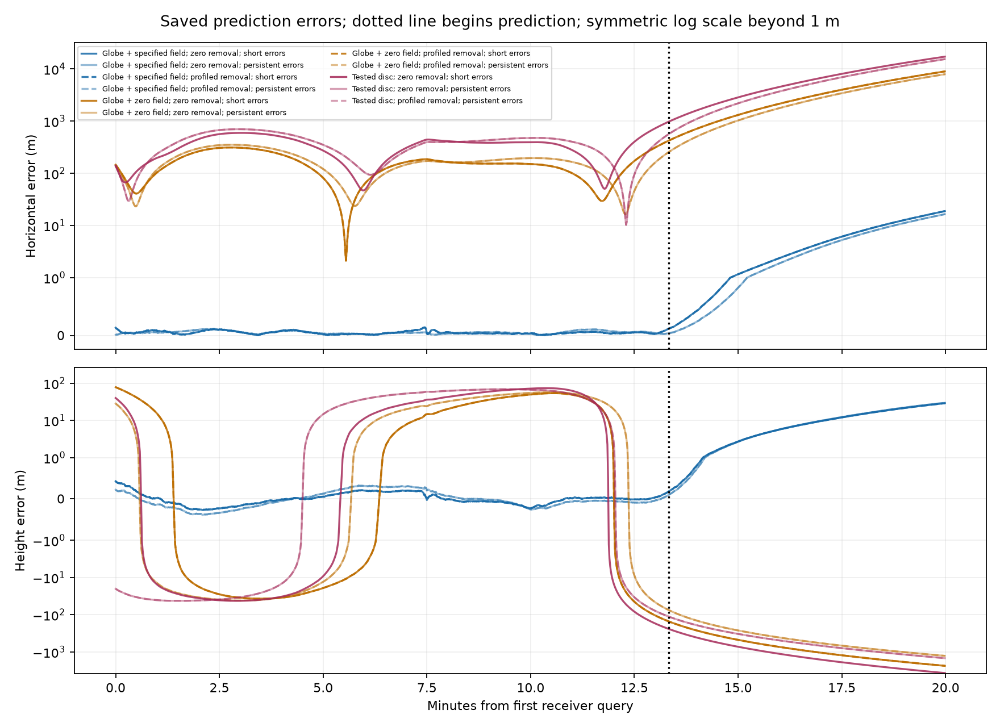

# What the saved prediction errors show

**22 saved error curves examined.** The two deadline-limited starts remain unavailable.
No new fit or aircraft propagation is performed. Every prediction, model choice and accuracy label is unchanged.

These settings reuse one development recording. They are not independent flights.
The plots show how errors grow during training and later prediction. The dotted line begins prediction.

| Candidate | Removal | Working errors | Weighted training RMS | Later N/E/up lag-one correlation |
|---|---|---|---:|---|
| Globe + specified field | Zero | Short memory | 0.5327 | 0.991 / 0.992 / 0.992 |
| Globe + specified field | Zero | Persistent | 0.06752 | 0.991 / 0.992 / 0.992 |
| Globe + specified field | Profiled | Short memory | 0.5327 | 0.991 / 0.992 / 0.992 |
| Globe + specified field | Profiled | Persistent | 0.06752 | 0.991 / 0.992 / 0.992 |
| Globe + zero field | Zero | Short memory | 1338 | 0.992 / 0.992 / 0.992 |
| Globe + zero field | Zero | Persistent | 83.61 | 0.992 / 0.992 / 0.992 |
| Globe + zero field | Profiled | Short memory | 1338 | 0.992 / 0.992 / 0.992 |
| Globe + zero field | Profiled | Persistent | 83.61 | 0.992 / 0.992 / 0.992 |
| Tested disc | Zero | Short memory | 2857 | 0.992 / 0.992 / 0.992 |
| Tested disc | Zero | Persistent | 175.1 | 0.992 / 0.992 / 0.992 |
| Tested disc | Profiled | Persistent | 175.1 | 0.992 / 0.992 / 0.992 |

A correlation near one means nearby errors move together. It is not raw receiver noise: aircraft reconstruction,
instrument calibration, receiver errors and model mismatch all contribute. Large slow trends can produce high
correlation. First differences describe changes between adjacent saved errors, using their actual time intervals;
they do not separate those causes.

Training and prediction are summarized separately. Centred Fourier variance describes fast and slow fluctuations
only when the original sampling is uniform; no interpolation is used. Sixty-second blocks are descriptive,
not independent trials. Constant signals have undefined correlations.

These are not calibrated confidence statements. Weighted training RMS describes an already fitted objective;
it is not a chi-squared test, an instrument accuracy measurement or a complete prediction-error law.
All 22 completed starts are retained in the statistics; the table and plot use the parent’s training-only choices.
Seven confirmation groups remain protected, and the 53-stretch findings remain unchanged.

[Axis statistics CSV](axis-statistics.csv) · [Diagnostic plan](PLAN.md) ·
[Parent prediction comparison](../esa-observed-wide-pilot/INTERPRETATION.md) · [Next analyses](../NEXT_STEPS.md)
