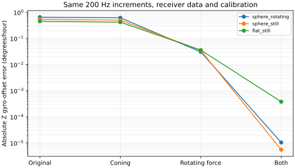

# Coning/sculling controls at the original 200 Hz

**9/9 new fits passed the predefined prediction/convergence checks.** Three
original fits were reused without refitting. The same synthetic increments, receiver
timestamps and injected calibration are used throughout. There are no NASA input
files, no observed-data starts and no change to the frozen archival integrator.
See the [predefined plan](PLAN.md).

An **IMU (inertial measurement unit)** measures turning and acceleration. Ordinary
integrals of those rates are not automatically equivalent to a finite rotation or
a velocity change expressed in a single fixed frame when the instrument moves.
Coning accounts for changing rotation axes; sculling/rotation compensation accounts
for rotating specific force. [Brouk and DeMars](https://ntrs.nasa.gov/citations/14626669150663)
discuss these effects and their uncertainty propagation. This candidate's particular
series is independently derived and tested here, not a claimed Applanix algorithm.

## What changed

Each control is the existing 12-second, 220 m/s equatorial track at 1,000 m altitude,
with known pitch/yaw, 24 receiver epochs and +0.25°/hour Z gyro offset. No samples
are inserted or discarded. A new forward model estimates linear rate variation from
three adjacent calibrated packet averages. Full integrals are preserved; partial
packet predictions include that variation rather than scaling the entire packet
uniformly. Calibration and latency derivatives include these corrections.

Five known-calibration modes separate the original predictor, linear partials,
coning, rotating-force compensation, and both. Coning/sculling fits use the original
solver from zero, with the same six nuisance bounds and synthetic 1 cm position
scale. Nonzero approximation errors are retained. Independent continuous differential
equations check constant-rate, single-axis and changing-axis packet behavior.
Disabled corrections reproduce the old values and derivatives exactly.

## Calibration fits

| True model | Method | Prediction check | Z offset error (°/hour) | Largest position error (m) |
|---|---|---|---:|---:|
| sphere_rotating | baseline | reused | 0.6462874259762825 | 4.572913867509711e-06 |
| sphere_still | baseline | reused | 0.5380627440836028 | 5.019167586869395e-06 |
| flat_still | baseline | reused | 0.451168252657868 | 5.205940466825125e-06 |
| sphere_rotating | coning | True | 0.6128621554185238 | 4.6589985105944576e-06 |
| sphere_rotating | sculling | True | 0.03041478010010207 | 8.462359057899145e-08 |
| sphere_rotating | combined | True | -1.0380442457893937e-05 | 4.0490216617968197e-10 |
| sphere_still | coning | True | 0.4967510576573305 | 5.087152613875235e-06 |
| sphere_still | sculling | True | 0.03471548614072839 | 6.67238109894388e-08 |
| sphere_still | combined | True | -5.475725546172891e-06 | 1.9124995738510818e-10 |
| flat_still | coning | True | 0.41662668970394023 | 5.2606896513272115e-06 |
| flat_still | sculling | True | 0.035677104784754124 | 5.532917456581546e-08 |
| flat_still | combined | True | 0.00037653280142348086 | 1.7159852849613274e-09 |



The plot shows absolute offset error with a 10⁻¹²°/hour display floor only. Signed
errors, gains, objectives, active limits and failures are retained in
[comparisons.csv](comparisons.csv) and complete saved diagnostics. A small position
error or successful stop alone does not establish correct calibration.

## Predictions at the injected calibration

| True model | Method | Largest position error (m) |
|---|---|---:|
| sphere_rotating | baseline | 4.10436e-05 |
| sphere_rotating | linear | 4.10436e-05 |
| sphere_rotating | coning | 1.96112e-05 |
| sphere_rotating | sculling | 3.51847e-05 |
| sphere_rotating | combined | 2.56293e-10 |
| sphere_still | baseline | 4.11712e-05 |
| sphere_still | linear | 4.11712e-05 |
| sphere_still | coning | 1.96755e-05 |
| sphere_still | sculling | 3.5298e-05 |
| sphere_still | combined | 2.56446e-10 |
| flat_still | baseline | 4.12039e-05 |
| flat_still | linear | 4.12039e-05 |
| flat_still | coning | 1.96906e-05 |
| flat_still | sculling | 3.53228e-05 |
| flat_still | combined | 2.56186e-10 |

These predictions use the known calibration, with no fitting. The linear-only row
isolates changed within-packet receiver timing from the higher-order corrections.
Each mode is used equally under all three true model identities; this is numerical
qualification, not choosing an Earth model from real observations.

## Scope and next decision

The candidate assumes ordinary integrated rates and truncated within-packet series.
It explicitly refuses enabled corrections for already-compensated input. The tests
do not establish which convention Applanix logged or whether all required onboard
corrections were applied. Frame rotation, Coriolis, position integration and gravity
retain the original geographic midpoint treatment. Noise, longer records, full
nuisance freedom and installation transfer remain separate qualifications.

Do not apply this candidate to NASA records merely because it improves these known
synthetic controls. First assess recovered calibration and remaining errors, then
qualify increment conventions and equally specified alternatives. Preserve original
measurements and results. Any observed comparison needs a separate finite allowance.

The completed report charged nine starts, with no retries, and used 359 new
native sweeps within its 1,815-sweep ceiling. Baseline work was reused. Packaging
reads saved results and starts no fits:

```sh
env PYTHONPATH=analysis MPLCONFIGDIR=/tmp/lll-compensation-matplotlib ~/venv/bin/python docs/ilvis0-compensation-controls-20261011/build_report.py --package-only
```
