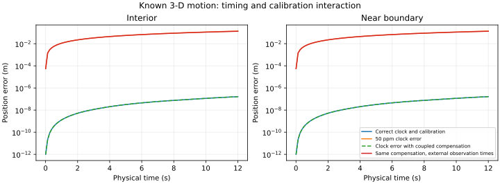

# Coupled three-dimensional clock and calibration controls

**Both independently generated controls passed.** Correct timing/calibration recovers
the known motion. A coordinated alternative can hide a clock error at packet endpoints,
but that particular alternative no longer predicts the same positions when observations
have independent time tags. This is software/physics evidence, not new NASA findings.
There were **zero observed-data fit starts and zero native navigation predictions**.

An **IMU (inertial measurement unit)** measures turning and acceleration. These controls
generate three-axis increments for a known moving and turning body in a Cartesian
frame, with explicit gravity and sensor mounting. No NASA measurements or Group1
fused navigation enter the controls. Background Earth/transport terms are zero; this
does not simulate or compare the three geographic Earth models.

## Known construction

Each control contains 2,400 samples at 200 Hz over 12 seconds, with six prescribed
rotation/acceleration legs. The initial velocity is 220 m/s north, 30 m/s east and
0.1 m/s down. One case uses interior calibration values; the second uses values near
the existing study's gain, offset and gravity allowances. Those injected values test
software behavior and are not manufacturer specifications or measured NASA calibration.

The generator integrates the rotating body's specific force analytically, separately
from the reconstruction's midpoint approximation. Numerical quadrature independently
checks that integral. Original physical angle increments are applied once. Known sensor
mounting, all three gain/offset pairs and gravity are explicit. The remaining small
correct-clock position error is the midpoint approximation's error in this control.

The existing Python strapdown primitive agrees with the independent reconstruction
within **0** in its component units. This check uses 4,800 Python primitive
steps in total, alongside 14,400 independent reconstruction steps. It does not exercise
the native geographic fitting kernel or qualify its nonlinear optimizer.

## Clock and calibration interaction

| Control | Reconstruction | Maximum position error (m) | Maximum attitude error (rad) |
|---|---|---:|---:|
| interior | correct_clock | 1.63853e-07 | 7.98e-18 |
| interior | wrong_clock | 0.137786 | 1.09e-09 |
| interior | coupled_compensation | 1.63846e-07 | 7.98e-18 |
| near_boundary | correct_clock | 1.64643e-07 | 7.98e-18 |
| near_boundary | wrong_clock | 0.137066 | 4.91e-09 |
| near_boundary | coupled_compensation | 1.64634e-07 | 7.98e-18 |

For clock scale c = 1.00005, the coupled alternative keeps gyro gain unchanged, divides
gyro and accelerometer offsets by c, replaces accelerometer gain by c(1 + gain) − 1,
divides initial velocity by c and gravity by c². Corrected angle increments stay the
same and velocity increments scale by 1/c. Multiplying those velocities by c times the
interval restores almost identical positions at corresponding packet endpoints.
The alternative's physical velocity and calibration differ from the injected truth.

This is a specific possible compensation mechanism. It does not establish which
parameters compensated in the NASA fits. In particular, the observed clock discrepancy
is much smaller than the repeatedly saturated Z gyro-gain allowance.



Correct-clock and packet-endpoint-compensated curves nearly coincide. The logarithmic
display uses a 10⁻¹² m floor for plotting only; numerical checks retain the actual errors.
Display traces contain every 25th sample plus the final endpoint, without interpolation.

## Independent observation times matter

The packet-endpoint equivalence associates observations by packet number. If receiver
positions instead refer to known physical times, the constructed alternative predicts
the original analytic path at t/c. Its maximum position discrepancy here is
**0.133232 m**. The check evaluates the exact piecewise-quadratic path, rather
than interpolating measured positions. It demonstrates that independent observation
time can expose this particular alternative; it does not prove all clock/calibration
ambiguities disappear when additional parameters are free.

An archival qualification control must therefore supply a separately time-tagged
receiver stream, latency assumptions and the actual packet/GPS association. Recovering
motion only at packet endpoints is insufficient. The logged NASA increment integration
period remains to be established or bracketed; these controls choose no real-data clock.

## Calibration recovery and remaining qualification

With the synthetic reference motion, mounting and clock known, SVD least squares and
QR independently recover all six gain/offset channels in both cases: 24 small linear
solves. Maximum gain error is 2.48e-13; maximum offset error is 2.44e-12 in its
channel units (rad/s or m/s²). Each two-column system has rank two; conditioning is
saved per channel. This is a test with known reference attitude and acceleration,
not calibration recovery from receiver positions alone.

Next qualify the complete nonlinear geographic fitter on independently generated
increments and external receiver epochs, including initialization, latency, coupled
calibration and difficult optima. Then prepare matched observed profiles with their
own finite allowance. The failed six-fit stopping trial and all original NASA findings
stay unchanged. See the [focused plan](../ILVIS0_DIAGNOSTIC_PLAN.md).

Reproduce these bounded software controls:

```sh
env PYTHONPATH=analysis OPENBLAS_NUM_THREADS=2 OMP_NUM_THREADS=2 MKL_NUM_THREADS=2 ~/venv/bin/python docs/ilvis0-coupled-controls-20261011/build_report.py
```
