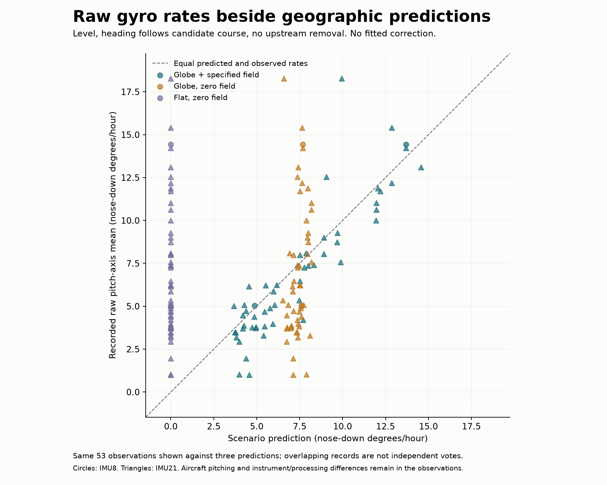

# Raw gyroscope rates and geographic predictions

Completed 48/48 independent controls and 53/53 saved-stretch comparisons. No fits or original-file reads.

The plot uses a declared level attitude, heading equal to each candidate’s receiver-derived course, and no upstream removal. All three predictions use the same raw gyro observations. Differences include unresolved aircraft motion, mounting and instrument processing. They are not independent estimates of those effects or a new scientific decision.

| Candidate | Stretches | Median absolute observed − scenario difference |
|---|---:|---:|
| sphere_rotating | 53 | 0.875 degrees/hour |
| sphere_still | 53 | 2.842 degrees/hour |
| flat_still | 53 | 5.866 degrees/hour |

[Every baseline comparison and source/group metadata](baseline-comparisons.csv) · [All fixed scenarios](scenario-comparisons.csv.gz) · [Frozen method and limits](PLAN.md) · [Original raw gyro plot](../ilvis0-gyro-overview/README.md).

The 243 scenarios per stretch vary declared crab, roll, pitch and processing. Their span is not a confidence interval or an exhaustive aircraft-motion envelope. No gyro bias/gain, field magnitude or aircraft attitude is fitted. Group-1 fused navigation is not used for prediction or motion subtraction. The preserved mounting transformation remains a legacy interpretation.

[Roadmap](../ANALYSIS_ROADMAP.md).
