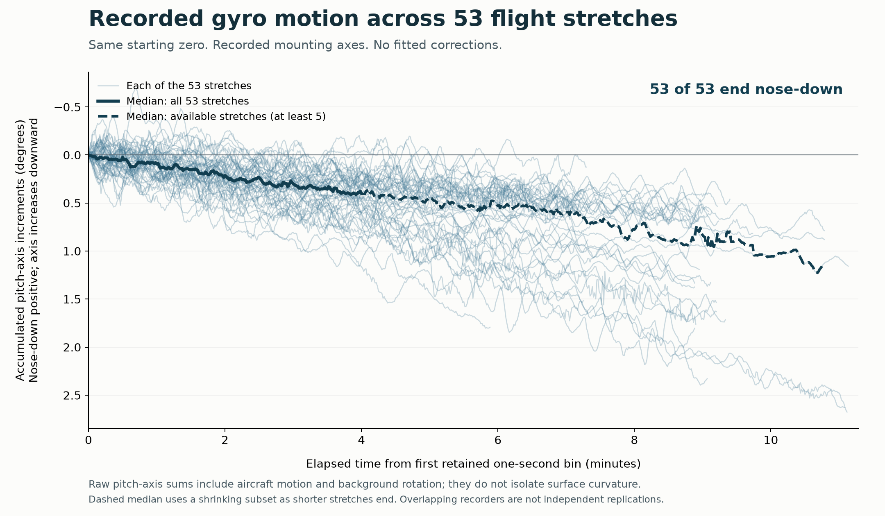

# A direct look at the gyroscope recordings

**All 53 stretches end with accumulated pitch-axis increments in the nose-down
direction.** Thin lines show each recording; the thick line shows their median.
Every line starts at zero. No individual recording is flipped or rescaled to match an
expected result. The vertical axis increases downward, so nose-down motion points
down the page; the underlying values and signs are unchanged. The solid median covers the common first four minutes; the dashed
median uses the recordings still available afterward, while at least five remain.

An **IMU (inertial measurement unit)** records angular and velocity increments.
This plot sums the recorded gyro increments around the aircraft's right-pointing
axis, using the mounting transformation preserved in the instrument configuration.
It uses no fitted calibration, GPS subtraction, fused navigation attitude or
assumed Earth-rate subtraction. GPS was used earlier to select these flight
stretches; no receiver values enter the plotted angles.

The sum is a direct descriptive measurement. It includes aircraft pitching,
coupling with other angular motion, instrument errors and any background angular
field retained in the logs. It is **not an isolated measurement of surface dip**
or a full three-dimensional attitude reconstruction. Normalizing each angular-rate
vector to unit length would remove the magnitude needed to calculate angles, so
the only display normalization is a common starting zero and the recorded axes.

The preserved one-second bins cover at least 99.5% of each selected interval;
partial edge bins omitted by the earlier descriptive export are not filled in.
There are no missing interior seconds in these traces. The bins already include
the established per-configuration unit conversion. No new fits or raw-file decoding
are required. Some simultaneous instrument records cover the same flight leg;
53 curves are not 53 independent flights.

[Full-size image](raw-pitch.png) · [Vector image](raw-pitch.svg) ·
[Plotted values](plotted-bins.csv.gz) · [All flight stretches](../ilvis0-current-findings-20261015/STRETCHES.md) ·
[Analysis method](../METHODOLOGY.md).

`build_plot.py` reproduces the figure from hash-checked preserved gyro bins.
`provenance.json` records its inputs, coverage, endpoint summaries and output hashes.
