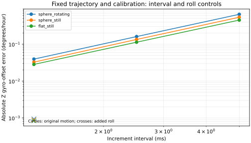

# Integration interval and calibration geometry controls

**9/9 new fits passed the predefined prediction/convergence checks.** Three
coarse results were reused without refitting. This study asks why the earlier
synthetic controls recovered positions accurately while recovering Z gyro offset
poorly. It adds no NASA findings or observed-data fits. See the [frozen plan](PLAN.md).

An **IMU (inertial measurement unit)** records turning and acceleration. These
controls reintegrate known continuous angular rate and specific force at 5, 2.5 and
1.25 ms intervals. The trajectory, 24 independently time-tagged receiver observations,
latency, calibration and initial state stay fixed. The three tracks are equatorial,
eastward at 220 m/s and 1,000 m altitude, for 12 seconds. True Z offset is +0.25°/hour.
All three geographic models have their own correctly generated control.

Finer samples are newly generated analytic integrals. No archival increments are
split, interpolated or altered. Variable-rate/near-boundary controls from the earlier
study are not refitted. The original six-parameter solver, bounds and common synthetic
covariance are retained; only interval or prescribed body roll changes.

The additional roll control is 0.35 sin(2πt/5.1) radians, about ±20°. Pitch and yaw
stay unchanged. It uses the same fine interval and receiver path. This informative
software motion tests conditioning and does not imply that archival flights contain
such a pattern. It is not a participant reversal protocol.

## Saved comparisons

| True model | Body motion | Interval (ms) | Prediction check | Z offset error (°/hour) | Largest position error (m) |
|---|---|---:|---|---:|---:|
| sphere_rotating | original | 5 | reused | 0.6462874259762825 | 4.572913867509711e-06 |
| sphere_still | original | 5 | reused | 0.5380627440836028 | 5.019167586869395e-06 |
| flat_still | original | 5 | reused | 0.451168252657868 | 5.205940466825125e-06 |
| sphere_rotating | original | 2.5 | True | 0.16105958140727256 | 1.1434428595105786e-06 |
| sphere_rotating | original | 1.25 | True | 0.03946256294766422 | 2.8606622632511596e-07 |
| sphere_rotating | roll | 1.25 | True | -0.0009405493862533305 | 5.173489658943206e-07 |
| sphere_still | original | 2.5 | True | 0.13443368845798348 | 1.2547767923086246e-06 |
| sphere_still | original | 1.25 | True | 0.03265317607078615 | 3.1397816446976995e-07 |
| sphere_still | roll | 1.25 | True | -0.0008941935881571414 | 5.200469181148014e-07 |
| flat_still | original | 2.5 | True | 0.11336043885786024 | 1.301586018887004e-06 |
| flat_still | original | 1.25 | True | 0.028365229148151486 | 3.2539410461373486e-07 |
| flat_still | roll | 1.25 | True | -0.0008426792148202469 | 5.195320695342516e-07 |

The original 5 ms rows come from the completed
[geographic controls](../ilvis0-geographic-controls-20261011/README.md). The original
[calibration audit](../ilvis0-geographic-controls-20261011/CALIBRATION.md) stays frozen.
Full fit/gradient/conditioning diagnostics and failures are retained. A passing
prediction check does not imply exact calibration recovery.



| True model | Error at half interval / coarse error | Error at quarter interval / coarse error | Roll / original error at quarter interval |
|---|---:|---:|---:|
| sphere_rotating | 0.2492 | 0.06106 | 0.02383 |
| sphere_still | 0.2498 | 0.06069 | 0.02738 |
| flat_still | 0.2513 | 0.06287 | 0.02971 |

Ratios compare absolute errors from matched known truth. They describe these controls;
they are not uncertainty intervals, significance levels or measured NASA performance.
The figure uses a 10⁻¹²°/hour display floor only. Results retain signed errors.

## Interpretation and limits

A reduction of offset error as the interval shrinks supports finite-interval
approximation being amplified by weak calibration geometry in these synthetic
controls. The matched fine-interval roll comparison tests geometry separately.
The measured ratios determine how strong that evidence is; no particular ratio is
required to declare the experiment complete. Good track reconstruction alone cannot
establish correctly recovered nuisance parameters.

These short controls have known continuous increments, no noise, no upstream rate
removal and six free parameters. They do not replicate unknown coning/sculling or
instrument preprocessing in the NASA recordings. They do not select its actual
integration clock, explain its boundary saturation or qualify all 27 nuisance
parameters. Refining actual logged packets without a physical basis is not justified.
Further integration/geometry controls need a separate source/configuration identity;
observed profiles require their own finite allowance.

The report charged nine starts with no retries and used 362 new native sweeps,
within the 1,809-sweep ceiling. Baseline sweeps belong to the original completed study
and were not repeated. Source/input/environment hashes and append-only starts are
preserved. Rebuild this report without starting fits:

```sh
env PYTHONPATH=analysis MPLCONFIGDIR=/tmp/lll-interval-matplotlib ~/venv/bin/python docs/ilvis0-interval-controls-20261011/build_report.py --package-only
```
