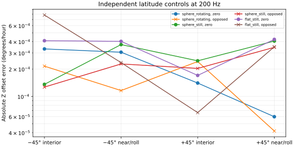

# Latitude and increment-convention controls

**24/24 software fits passed the predefined numerical checks.**
This extends the [original-rate comparison](../ilvis0-compensation-controls-20261011/FINDINGS.md)
to +45° and −45° latitude. No NASA recordings were refitted. See the [frozen plan](PLAN.md).

An **IMU (inertial measurement unit)** records turning and acceleration. These controls
use independently calculated motion and known calibration to test the software, rather
than infer an Earth model from real measurements. Each model receives observations
generated from its own physical truth. All tracks last 12 seconds at 220 m/s and 1,000 m.

## Calibration recovery

The interior case uses pitch/yaw and regular timing. The near/roll case combines added
roll, unequal timing and calibration close to its limits. Both run from zero and a
deliberately opposed start, with the same original six-parameter bounds and solver.
Pass criteria check convergence and position prediction; calibration error is separately
reported and can expose weakness even when a fit passes. These noise-free short tracks
do not qualify full archival nuisance freedom or uncertainty estimates.



| Control identity: model / latitude / construction / start | Numerical pass | Z offset error (°/hour) | Maximum position error (m) |
|---|---|---:|---:|
| sphere_rotating::-45::interior::zero | yes | 0.00033241612060354536 | 8.695278573223765e-10 |
| sphere_rotating::-45::interior::opposed | yes | -0.00021503608624073744 | 7.170313476266573e-10 |
| sphere_rotating::-45::near_roll::zero | yes | -0.0003061295293195804 | 2.918199964622211e-09 |
| sphere_rotating::-45::near_roll::opposed | yes | 0.00011600998645740039 | 8.5933908101292e-10 |
| sphere_rotating::+45::interior::zero | yes | 0.0001403357498050899 | 5.716839490113878e-10 |
| sphere_rotating::+45::interior::opposed | yes | -0.00024167903774246363 | 9.115346256409082e-10 |
| sphere_rotating::+45::near_roll::zero | yes | 5.984025833653465e-05 | 6.817875984741058e-10 |
| sphere_rotating::+45::near_roll::opposed | yes | 4.17169305767744e-05 | 6.327287815071813e-10 |
| sphere_still::-45::interior::zero | yes | 0.00013576341815423079 | 6.520234242794834e-10 |
| sphere_still::-45::interior::opposed | yes | -0.00012669970092617095 | 5.768276349279427e-10 |
| sphere_still::-45::near_roll::zero | yes | -0.00037117033563245866 | 2.984914791637915e-09 |
| sphere_still::-45::near_roll::opposed | yes | 0.0002273953753818805 | 1.403568358833388e-09 |
| sphere_still::+45::interior::zero | yes | 0.00024615226357556065 | 9.22763475699816e-10 |
| sphere_still::+45::interior::opposed | yes | -0.00020310193465824158 | 7.44119895928276e-10 |
| sphere_still::+45::near_roll::zero | yes | -0.0004059109326854813 | 3.3120312798658384e-09 |
| sphere_still::+45::near_roll::opposed | yes | -0.0003463110468685448 | 2.975548278857464e-09 |
| flat_still::-45::interior::zero | yes | 0.00040916737106576557 | 1.988027948751934e-09 |
| flat_still::-45::interior::opposed | yes | -0.0007833450216308053 | 2.6398537313758797e-09 |
| flat_still::-45::near_roll::zero | yes | -0.0004028607236836542 | 3.2029920051054275e-09 |
| flat_still::-45::near_roll::opposed | yes | -0.00023538333640778952 | 2.278427855642444e-09 |
| flat_still::+45::interior::zero | yes | 0.00017018081292698755 | 1.0841977875955902e-09 |
| flat_still::+45::interior::opposed | yes | 6.64312989094944e-05 | 2.1639368210081254e-10 |
| flat_still::+45::near_roll::zero | yes | -0.0004232350705416418 | 3.381307270667418e-09 |
| flat_still::+45::near_roll::opposed | yes | -0.00035100913922548466 | 3.0391921347189644e-09 |

## Why the increment convention matters

The additional controls define already-compensated increments from exact attitude
endpoints and an independently integrated force. Receiver observations occur at packet
endpoints. The second column of errors deliberately mislabels these measurements as
ordinary integrated rates, so the candidate applies an inappropriate second correction.
Correctly labelled inputs are rejected by the enabled correction's guard.

| Supplied truth | Latitude | Appropriate original treatment: error (m) | Deliberate double correction: error (m) |
|---|---:|---:|---:|
| sphere_rotating | -45° | 0.0 | 4.144646863046123e-05 |
| sphere_rotating | +45° | 0.0 | 4.1529090367724386e-05 |
| sphere_still | -45° | 0.0 | 4.1574526940765726e-05 |
| sphere_still | +45° | 0.0 | 4.159019531024272e-05 |
| flat_still | -45° | 0.0 | 4.161536212986764e-05 |
| flat_still | +45° | 0.0 | 4.162371511561573e-05 |

This mathematical convention is precisely defined for this control. It is not a claim
about Applanix firmware. Partial-packet finite increments need their own convention;
these endpoint checks do not qualify arbitrary interpolation. Neither correction path
can be assigned to the NASA archive solely because one wins on a software control.

## Reproducibility and limits

The run charged 24 fit starts and 36
known-calibration predictions, using 1042 native sweeps within the 4,836-sweep ceiling,
with no retries. See [fit details](fits.csv) and [known-calibration checks](known-calibration.csv).
Sources, environment, compiler and native binary are hashed; interrupted starts remain
charged. The archive's scientific evidence gate is unchanged.

Publication reads saved results and starts no fits:

```sh
env PYTHONPATH=analysis MPLCONFIGDIR=/tmp/lll-latitude-matplotlib ~/venv/bin/python docs/ilvis0-latitude-controls-20261011/build_report.py --package-only
```
