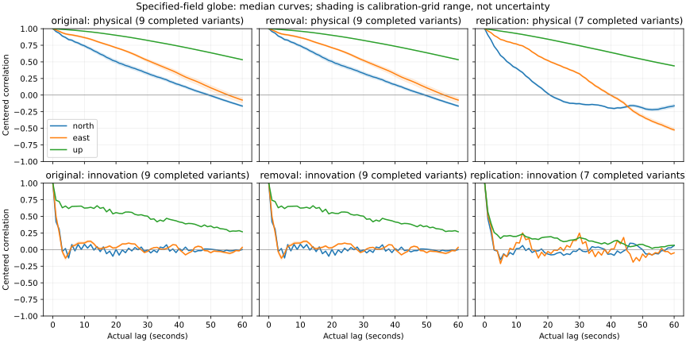
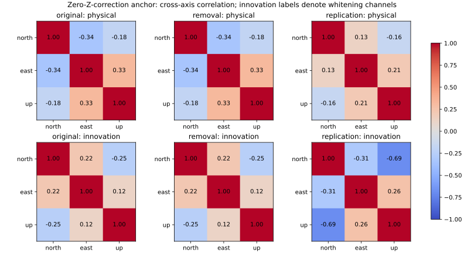
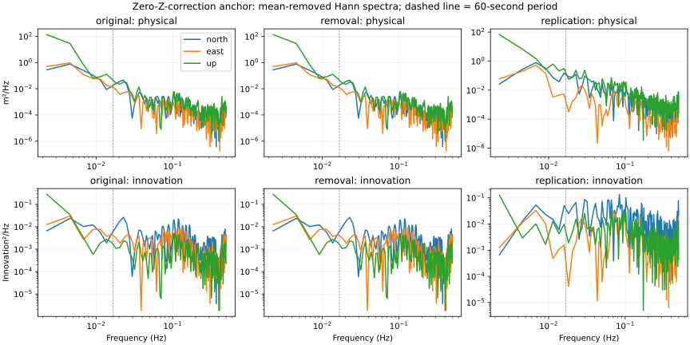

# Are the remaining track errors independent?

**The saved errors remain correlated after the current whitening. A shared error model needs further qualification.**
This audit does not alter the observed model separation, any convergence label or any scientific decision.

An IMU (inertial measurement unit) measures turning and acceleration. This report examines saved position errors
from 81 fits of two survey-grade IMU recordings, not 81 independent flights. The first two grids reuse October 5;
the third uses the preselected September 24 stretch. Each spans roughly seven minutes.

## Correlation after whitening

The table summarizes completed specified-field globe fits across their fixed Z calibration variants.
The two unfinished September 24 fits remain in the detailed tables, with their original status.

| Grid / innovation channel | Completed variants | Median RMS | Lag 1 / 10 / 60 seconds | Power at periods ≥60 seconds |
|---|---:|---:|---:|---:|
| original / north | 9 | 0.0474 | 0.418 / 0.080 / -0.000 | 9.3% |
| original / east | 9 | 0.0358 | 0.503 / 0.099 / 0.034 | 18.4% |
| original / up | 9 | 0.0423 | 0.744 / 0.625 / 0.268 | 67.6% |
| removal / north | 9 | 0.0474 | 0.418 / 0.080 / -0.000 | 9.3% |
| removal / east | 9 | 0.0358 | 0.503 / 0.099 / 0.034 | 18.4% |
| removal / up | 9 | 0.0423 | 0.744 / 0.625 / 0.268 | 67.6% |
| replication / north | 7 | 0.0886 | 0.466 / 0.014 / 0.060 | 4.4% |
| replication / east | 7 | 0.0335 | 0.511 / 0.106 / -0.050 | 8.6% |
| replication / up | 7 | 0.0617 | 0.568 / 0.199 / 0.065 | 14.9% |

Whitening expresses errors relative to the assumed covariance. Its channel labels follow the saved factorization;
they are not three new independent physical sensors. Small innovation RMS values do not establish GPS precision
or calibrated likelihoods. Correlation can reflect receiver error, IMU error, fitted calibration and model mismatch.



Lines are medians over calibration-grid variants. Shaded ranges show sensitivity to those choices, not confidence intervals.
Each grid is kept separate. All physical models are included in the detailed tables; their mismatches are not pooled as noise.

## Cross-axis and slow behavior



These matrices use the predeclared zero-gain/zero-offset grid anchor. The physical residuals share one north/east/up
conversion for all models: latitude and longitude errors use the receiver’s latitude, height and a 6,378,137 m radius.
The covariance is centered over the complete record, so constant residual means are reported separately.



The spectra remove the mean and apply a Hann window; no linear trend is removed. The dashed line marks a
60-second period. Positive-frequency band power excludes DC and is a fraction of the displayed spectrum,
not an estimate of sensor drift. These approximately seven-minute records offer only a few minute-scale cycles.
Longer-than-record periods, multi-hour drift and unique correlation time scales cannot be established here.

## Methods and scope

Lag products are centered using the whole-record mean and divided by the total epoch count, including at nonzero lag.
Every lag retains pair count and actual minimum/median/maximum elapsed times. All series retain their saved timestamps.
Uniform cadence is checked within 1 part per million (at least 1 ns); irregular series receive lag diagnostics but no FFT.
There is no interpolation or resampling. The one-sided periodogram uses interval/window normalization verified by
frequency and time-domain energy controls, for both odd and even sample counts.

Selected receiver epochs preserve position/time but no fix-quality or precision fields. This audit does not invent
formal receiver covariance. Empirical fitted residual covariance is not uniquely the receiver’s measurement covariance,
and these descriptive checks do not prove stationarity. Group1 fused navigation supplies no independent inertial evidence.

Detailed outputs: [axis summaries](axes.csv), [cross-axis matrices](cross-axis.csv),
[dense lag matrices](lags.csv.gz) and [spectral bins](spectra.csv.gz). Failures remain explicitly labeled.
All input hashes, completion receipts and saved epoch RMS/objectives are checked before analysis.
This work adds **zero optimizer starts and zero native predictions**.

## Next step

The [shared error-model plan](ERROR_MODEL_PLAN.md) describes a covariance with white error, correlated error
and cross-axis terms. Its specification must be justified or estimated on designated development data, then frozen
identically for all physical candidates and tested with blocked predictions. It is not fitted or deployed here.
A new observed-data comparison needs separate numerical qualification and a finite allowance.
The globe/flat hierarchy and distinction between a measured background field and its physical cause remain unchanged.

## Reproduce

```sh
env PYTHONPATH=analysis OPENBLAS_NUM_THREADS=2 OMP_NUM_THREADS=2 MKL_NUM_THREADS=2 ~/venv/bin/python docs/ilvis0-residual-covariance-20261012/build_report.py
```
