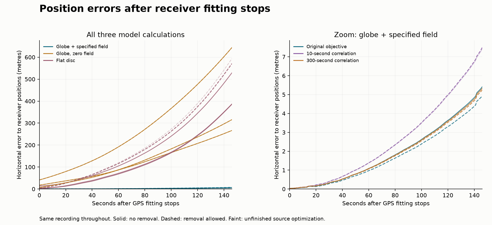

# What happens after GPS fitting stops?

The globe model with the specified field remains much closer horizontally to the withheld receiver positions. Their errors still grow to several metres; this is a useful prediction check, not a calibrated detection.

This is **one recording**, IMU type 21: `ILVIS0_applanix_57300_610_LVIS_38614965.013`. Its selected stretch lasts 7.30 minutes at median ground speed 878.1 km/h. Calibration used the first 4.85 minutes of receiver positions. The calculation then continued for 2.43 minutes using the later IMU (inertial measurement unit) observations while withholding later GPS positions, with no GPS reset.

**Eighteen saved fits reuse those same measurements:** six from the earlier prediction study and twelve from the receiver-correlation comparison. **15/18 passed their original stopping checks; three remain unfinished.** Only three of six matched model sets are numerically complete. These are neither eighteen flights nor new independent replications.

| Fitting/error assumption | Processing | Model | Original stopping status | Prediction horizontal RMS | Vertical RMS | Final horizontal error |
|---|---|---|---|---:|---:|---:|
| Original objective | Removal allowed | Globe + specified field | converged | 2.22 m | 3.33 m | 4.92 m |
| Original objective | Removal allowed | Globe, zero field | converged | 142.91 m | 2.03 m | 266.31 m |
| Original objective | Removal allowed | Flat disc | unresolved | 255.78 m | 2.56 m | 572.49 m |
| Original objective | No removal | Globe + specified field | converged | 2.45 m | 3.33 m | 5.41 m |
| Original objective | No removal | Globe, zero field | converged | 142.91 m | 2.03 m | 266.33 m |
| Original objective | No removal | Flat disc | converged | 165.96 m | 3.17 m | 385.66 m |
| 10-second correlation | Removal allowed | Globe + specified field | converged | 3.35 m | 3.47 m | 7.49 m |
| 10-second correlation | Removal allowed | Globe, zero field | converged | 328.14 m | 0.91 m | 643.76 m |
| 10-second correlation | Removal allowed | Flat disc | unresolved | 265.38 m | 1.95 m | 593.63 m |
| 10-second correlation | No removal | Globe + specified field | unresolved | 3.32 m | 3.48 m | 7.43 m |
| 10-second correlation | No removal | Globe, zero field | converged | 328.15 m | 0.91 m | 643.80 m |
| 10-second correlation | No removal | Flat disc | converged | 235.20 m | 5.66 m | 528.77 m |
| 300-second correlation | Removal allowed | Globe + specified field | converged | 2.38 m | 3.23 m | 5.24 m |
| 300-second correlation | Removal allowed | Globe, zero field | converged | 160.56 m | 1.98 m | 315.70 m |
| 300-second correlation | Removal allowed | Flat disc | converged | 255.36 m | 3.07 m | 570.35 m |
| 300-second correlation | No removal | Globe + specified field | converged | 2.42 m | 3.23 m | 5.33 m |
| 300-second correlation | No removal | Globe, zero field | converged | 160.56 m | 1.98 m | 315.70 m |
| 300-second correlation | No removal | Flat disc | converged | 167.74 m | 2.16 m | 386.95 m |

The globe model with the specified field has horizontal RMS from 2.22 to 3.35 m across these saved calculations; the zero-field globe and flat-disc trajectories diverge much farther horizontally. An unfinished fit has not established its model’s best result and is not equal support for competing models. No new model winner or background-field conclusion is assigned here.

The curves use direct errors, without a receiver-error conditioning adjustment. The common sign and growth patterns include calibration/model deficiencies and correlated receiver errors; their relative contributions remain unresolved. Uncertainty from nuisance fitting is not calibrated, and no absolute adequacy cutoff is chosen after examining these errors. The recording had already informed development, so the check is retrospective.

[All comparison metadata](comparisons.csv) · [Thirty-second error sections](sections.csv) · [Every saved epoch](epochs.csv.gz) · [Audit scope](PLAN.md).

[Original six-fit result](../ilvis0-prediction-trial-20261011/RESULTS.md) · [Original twelve-fit result](../ilvis0-prediction-covariance-20261012/RESULTS.md) · [All selected stretches](../ilvis0-current-findings-20261015/STRETCHES.md) · [Next analyses](../NEXT_STEPS.md).
