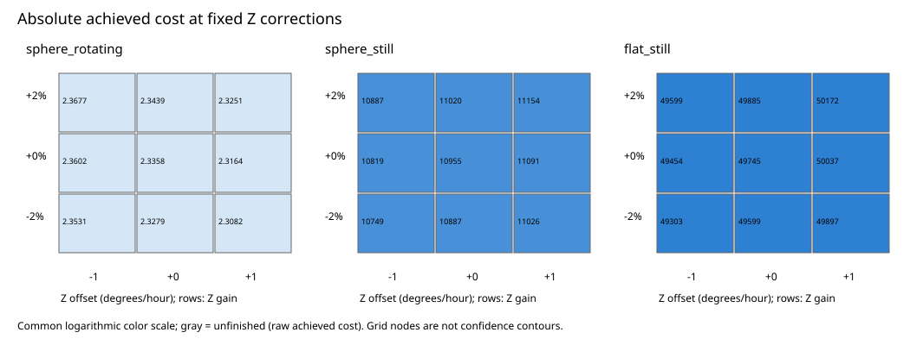
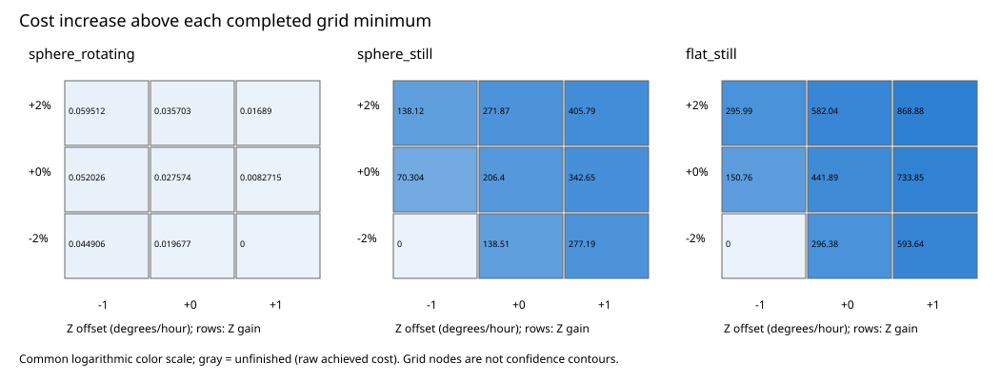

# Joint Z-axis profile results

Completed 27 charged starts on one recording and one processing case. All failures remain recorded.
IMU means inertial measurement unit. The fixed gain/offset grid tests calibration sensitivity, not instrument drift.

| Model | Gain (%) | Offset (degrees/hour) | Status | Achieved cost |
|---|---:|---:|---|---:|
| sphere_rotating | -2 | -1 | converged | 2.35308 |
| sphere_still | -2 | -1 | converged | 10748.6 |
| flat_still | -2 | -1 | converged | 49303 |
| sphere_rotating | -2 | 0 | converged | 2.32785 |
| sphere_still | -2 | 0 | converged | 10887.1 |
| flat_still | -2 | 0 | converged | 49599.4 |
| sphere_rotating | -2 | 1 | converged | 2.30818 |
| sphere_still | -2 | 1 | converged | 11025.8 |
| flat_still | -2 | 1 | converged | 49896.6 |
| sphere_rotating | 0 | -1 | converged | 2.3602 |
| sphere_still | 0 | -1 | converged | 10818.9 |
| flat_still | 0 | -1 | converged | 49453.7 |
| sphere_rotating | 0 | 0 | converged | 2.33575 |
| sphere_still | 0 | 0 | converged | 10955 |
| flat_still | 0 | 0 | converged | 49744.9 |
| sphere_rotating | 0 | 1 | converged | 2.31645 |
| sphere_still | 0 | 1 | converged | 11091.2 |
| flat_still | 0 | 1 | converged | 50036.8 |
| sphere_rotating | 2 | -1 | converged | 2.36769 |
| sphere_still | 2 | -1 | converged | 10886.7 |
| flat_still | 2 | -1 | converged | 49599 |
| sphere_rotating | 2 | 0 | converged | 2.34388 |
| sphere_still | 2 | 0 | converged | 11020.4 |
| flat_still | 2 | 0 | converged | 49885 |
| sphere_rotating | 2 | 1 | converged | 2.32507 |
| sphere_still | 2 | 1 | converged | 11154.4 |
| flat_still | 2 | 1 | converged | 50171.9 |

Complete-grid shape preference: **globe**.
Unfinished points give upper bounds on their unknown best fits; they do not complete a profile surface.

Figures show the nine grid nodes without interpolating unfinished points. Gray nodes retain raw achieved costs.
The coarse grid cannot establish a global optimum or calibrated confidence region.
Model names specify background fields, not their cause. Other processing cases, clocks and recordings remain untested.

[Preparation and reproduction instructions](README.md). All scientific decisions abstain.
