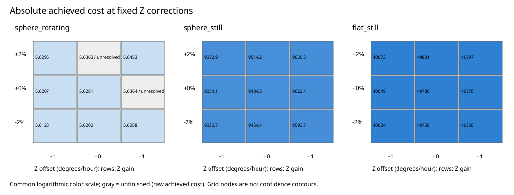
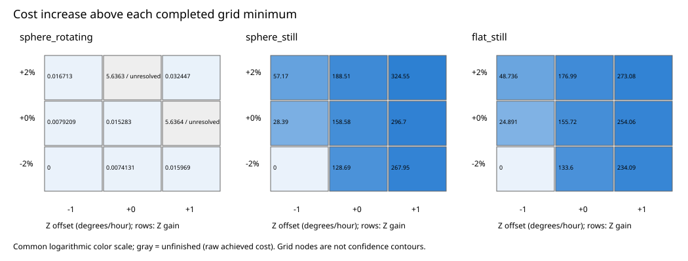

# Joint Z-axis profile results

Completed 27 charged starts on one recording and one processing case. All failures remain recorded.
IMU means inertial measurement unit. The fixed gain/offset grid tests calibration sensitivity, not instrument drift.

| Model | Gain (%) | Offset (degrees/hour) | Status | Achieved cost |
|---|---:|---:|---|---:|
| sphere_rotating | -2 | -1 | converged | 5.61282 |
| sphere_still | -2 | -1 | converged | 9325.73 |
| flat_still | -2 | -1 | converged | 40624.4 |
| sphere_rotating | -2 | 0 | converged | 5.62023 |
| sphere_still | -2 | 0 | converged | 9454.42 |
| flat_still | -2 | 0 | converged | 40758 |
| sphere_rotating | -2 | 1 | converged | 5.62879 |
| sphere_still | -2 | 1 | converged | 9593.68 |
| flat_still | -2 | 1 | converged | 40858.5 |
| sphere_rotating | 0 | -1 | converged | 5.62074 |
| sphere_still | 0 | -1 | converged | 9354.12 |
| flat_still | 0 | -1 | converged | 40649.3 |
| sphere_rotating | 0 | 0 | converged | 5.6281 |
| sphere_still | 0 | 0 | converged | 9484.31 |
| flat_still | 0 | 0 | converged | 40780.1 |
| sphere_rotating | 0 | 1 | unresolved | 5.63637 |
| sphere_still | 0 | 1 | converged | 9622.43 |
| flat_still | 0 | 1 | converged | 40878.5 |
| sphere_rotating | 2 | -1 | converged | 5.62953 |
| sphere_still | 2 | -1 | converged | 9382.9 |
| flat_still | 2 | -1 | converged | 40673.1 |
| sphere_rotating | 2 | 0 | unresolved | 5.63628 |
| sphere_still | 2 | 0 | converged | 9514.24 |
| flat_still | 2 | 0 | converged | 40801.4 |
| sphere_rotating | 2 | 1 | converged | 5.64527 |
| sphere_still | 2 | 1 | converged | 9650.28 |
| flat_still | 2 | 1 | converged | 40897.5 |

Complete-grid shape preference: **unresolved**.
Unfinished points give upper bounds on their unknown best fits; they do not complete a profile surface.

Figures show the nine grid nodes without interpolating unfinished points. Gray nodes retain raw achieved costs.
The coarse grid cannot establish a global optimum or calibrated confidence region.
Model names specify background fields, not their cause. This separate grid changes only its declared processing case or recording.

[Preparation and reproduction instructions](README.md). All scientific decisions abstain.
